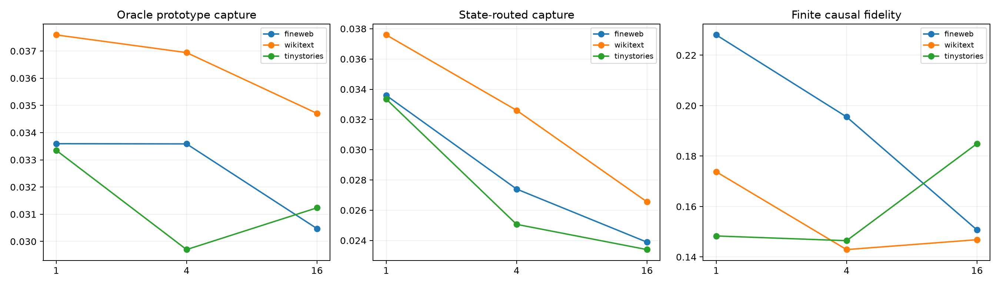

# Conditional quantization of Layer-8 local Fisher subspaces

Exact suffix Jacobians define a rank-four optimal input-sensitivity subspace at each state. FineWeb discovery subspaces are Grassmann-clustered into 1, 4, or 16 prototypes. A frozen nearest-centroid router sees only the current Layer-8 state; an oracle chooses the best prototype using the held-out Fisher Gram. Leading prototype directions are validated by exact 1%-norm interventions through layers 8--17.

## Locked hypotheses

- **M1_sixteen_prototypes_cover_local_subspaces: not supported.**
- **M2_state_router_recovers_prototype: not supported.**
- **M3_routed_prototype_has_finite_causal_fidelity: not supported.**
- **M4_quantization_beats_single_global_space: not supported.**
- **M5_middle_conditional_code_transfers_ood: supported.**
- **M6_state_router_matches_oracle_cluster: not supported.**

| Corpus | K | Oracle/routed/random capture | Route match | Finite fidelity/cosine | KL ratio to local |
|---|---:|---:|---:|---:|---:|
| fineweb | 1 | 0.034/0.034/0.012 | 1.000 | 0.228/0.655 | 0.038 |
| fineweb | 4 | 0.034/0.027/0.020 | 0.333 | 0.196/0.680 | 0.026 |
| fineweb | 16 | 0.030/0.024/0.021 | 0.125 | 0.151/0.653 | 0.025 |
| wikitext | 1 | 0.038/0.038/0.016 | 1.000 | 0.174/0.564 | 0.040 |
| wikitext | 4 | 0.037/0.033/0.020 | 0.208 | 0.143/0.528 | 0.030 |
| wikitext | 16 | 0.035/0.027/0.023 | 0.042 | 0.147/0.692 | 0.024 |
| tinystories | 1 | 0.033/0.033/0.015 | 1.000 | 0.148/0.603 | 0.033 |
| tinystories | 4 | 0.030/0.025/0.019 | 0.375 | 0.146/0.542 | 0.028 |
| tinystories | 16 | 0.031/0.023/0.021 | 0.250 | 0.185/0.713 | 0.022 |

This distinguishes three levels: per-state compactness, finite vocabulary quantizability, and predictable routing from native state. Failure at the latter two does not negate the exact local rank result.
