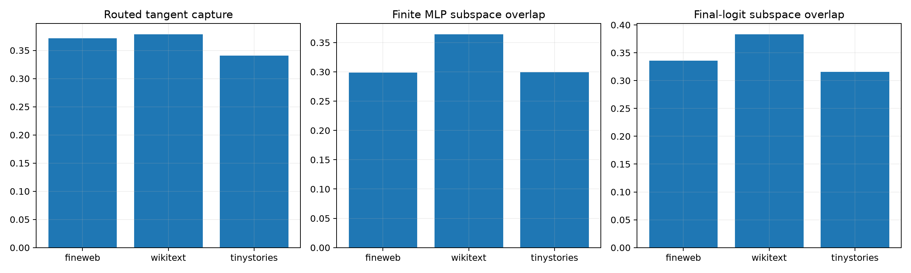

# Finite causal red team of Layer-8 direct prototypes

The frozen 64-prototype bank is routed only from the native Layer-8 state. Matched random subspaces test spectral specificity. At each held-out site, the local-optimal and routed rank-four coefficient spaces are edited at 1% input norm; resulting MLP-write and final-logit effect subspaces are compared after full nonlinear recomputation.

## Locked hypotheses

- **P1_learned_bank_beats_random: supported.**
- **P2_state_router_retains_direct_energy: supported.**
- **P3_finite_mlp_subspace_transfers: not supported.**
- **P4_suffix_effect_partially_transfers: not supported.**
- **P5_finite_direct_energy_calibrates: supported.**
- **P6_direct_prototype_causality_is_ood_stable: supported.**

| Corpus | Oracle/routed/random capture | Finite MLP overlap | Suffix overlap | Finite energy ratio |
|---|---:|---:|---:|---:|
| fineweb | 0.432/0.372/0.163 | 0.299 | 0.336 | 0.357 |
| wikitext | 0.474/0.379/0.136 | 0.364 | 0.383 | 0.379 |
| tinystories | 0.469/0.341/0.165 | 0.299 | 0.316 | 0.339 |

High native-write overlap with weak suffix overlap would validate the prototypes as layer-local tensor verbs while rejecting them as complete downstream behavioral circuits.
