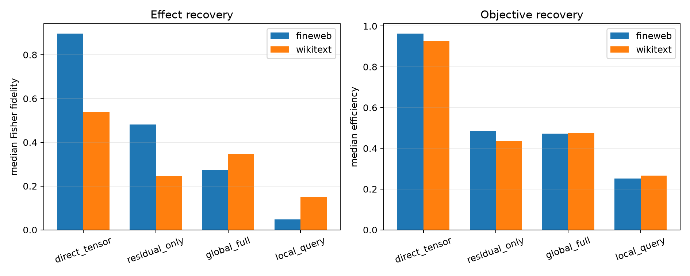

# Analytic direct tensor Jacobian through Layers 9–17

All 512 Layer-8 mode write tangents are propagated through the exact learned residual coefficients, RMSNorm Jacobians, and bilinear MLP Jacobians of Layers 9–17. Native attention writes are recomputed, but their derivatives are clamped to zero. The final RMSNorm, unembedding, bounded-logit derivative, and full-vocabulary softmax Fisher metric are exact. `Residual only` omits every downstream MLP Jacobian. No corpus bank, learned router, or suffix backpropagation is used for these two routes.

## Locked hypotheses

- **T1_direct_tensor_recovers_oracle_direction: not supported.**
- **T2_direct_tensor_recovers_oracle_magnitude: supported.**
- **T3_direct_tensor_recovers_oracle_objective: supported.**
- **T4_direct_tangent_predicts_finite_edit: not supported.**
- **T5_bilinear_jacobians_add_value: supported.**
- **T6_direct_tensor_beats_global_metric: not supported.**
- **T7_direct_tensor_ood_stability: not supported.**

| Corpus | Route | Exact KL | KL/oracle | Oracle fidelity/cosine | Objective efficiency | Support recall | Tangent→finite fidelity/cosine |
|---|---|---:|---:|---:|---:|---:|---:|
| fineweb | oracle | 2.911e-03 | 1.000 | 1.000/1.000 | 1.000 | 1.000 | — |
| fineweb | direct_tensor | 2.440e-03 | 0.838 | 0.896/0.955 | 0.963 | 0.375 | 0.788/0.973 |
| fineweb | residual_only | 8.620e-04 | 0.296 | 0.482/0.779 | 0.487 | 0.188 | -3.244/0.506 |
| fineweb | global_full | 7.970e-04 | 0.274 | 0.272/0.693 | 0.472 | 0.125 | — |
| fineweb | local_query | 3.770e-04 | 0.130 | 0.048/0.346 | 0.251 | 0.062 | — |
| wikitext | oracle | 4.571e-03 | 1.000 | 1.000/1.000 | 1.000 | 1.000 | — |
| wikitext | direct_tensor | 3.612e-03 | 0.790 | 0.540/0.774 | 0.925 | 0.375 | 0.852/0.933 |
| wikitext | residual_only | 1.384e-03 | 0.303 | 0.247/0.506 | 0.436 | 0.062 | -1.448/0.452 |
| wikitext | global_full | 1.662e-03 | 0.364 | 0.346/0.636 | 0.474 | 0.062 | — |
| wikitext | local_query | 1.079e-03 | 0.236 | 0.151/0.488 | 0.267 | 0.094 | — |

Success would identify a weight-derived, state-specific causal metric in the tensor/residual path. Failure would show that the small attention-only finite effect can still be essential for choosing the right program, or that tangent selection does not survive the finite joint edit.
