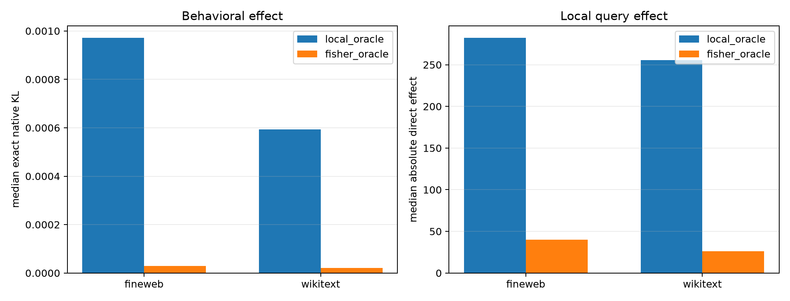

# Local tensor-score versus downstream-Fisher mode oracles

For each held-out state and natural output query, the existing local oracle ranks the query form's 512 eigenmodes by absolute scalar contribution. The new downstream oracle ranks the same modes by a Monte Carlo estimate of their Fisher-weighted final-logit effect after propagation through layers 9–17. Selection uses one 16-sample score-function sketch; an independent 16-sample sketch measures stability. Both routes receive the same 16-mode and 5%-input-norm intervention budget.

Single-mode validation removes 10% of a mode's naturally present component. Each Fisher-top mode is paired with a non-top mode having the closest local query-contribution magnitude, so the control asks whether downstream weighting adds information beyond local amplitude.

## Locked hypotheses

- **F1_fisher_sketch_is_stable: not supported.**
- **F2_fisher_route_has_larger_behavioral_effect: not supported.**
- **F3_local_route_has_larger_query_effect: supported.**
- **F4_local_and_fisher_supports_differ: supported.**
- **F5_hierarchy_is_closer_to_local_target: supported.**
- **F6_fisher_ranking_predicts_finite_single_modes: supported.**

| Corpus | Valid sketches; corr./top16 recall | Route | Native KL | |query effect| | Local/Fisher support | Fidelity to local/Fisher effect |
|---|---:|---|---:|---:|---:|---:|
| fineweb | 0.812; 0.952/0.781 | local_oracle | 9.717e-04 | 2.824e+02 | 1.000/0.312 | 1.000/-28.351 |
| fineweb | 0.812; 0.952/0.781 | fisher_oracle | 2.912e-05 | 3.993e+01 | 0.312/1.000 | 0.201/1.000 |
| fineweb | 0.812; 0.952/0.781 | flat256 | 9.224e-04 | 2.621e+02 | 0.688/0.250 | 0.886/-26.636 |
| fineweb | 0.812; 0.952/0.781 | hierarchical128 | 9.255e-04 | 2.771e+02 | 0.688/0.250 | 0.853/-24.734 |
| fineweb | 0.812; 0.952/0.781 | fixed16 | 1.113e-03 | 2.243e+02 | 0.312/0.188 | 0.611/-39.090 |
| fineweb | — | matched single-mode validation | KL ratio **112.52×** | win rate **0.914** | — | — |
| wikitext | 0.969; 0.966/0.750 | local_oracle | 5.933e-04 | 2.555e+02 | 1.000/0.250 | 1.000/-18.425 |
| wikitext | 0.969; 0.966/0.750 | fisher_oracle | 2.157e-05 | 2.636e+01 | 0.250/1.000 | 0.201/1.000 |
| wikitext | 0.969; 0.966/0.750 | flat256 | 4.981e-04 | 2.250e+02 | 0.688/0.250 | 0.824/-18.251 |
| wikitext | 0.969; 0.966/0.750 | hierarchical128 | 4.919e-04 | 2.215e+02 | 0.688/0.250 | 0.803/-17.130 |
| wikitext | 0.969; 0.966/0.750 | fixed16 | 8.349e-04 | 1.860e+02 | 0.250/0.125 | 0.156/-26.134 |
| wikitext | — | matched single-mode validation | KL ratio **103.03×** | win rate **0.977** | — | — |

The downstream oracle is not a better semantic explanation by definition. It answers which locally available eigenmodes most affect the final distribution at this state. The local oracle answers which modes implement a specified layer-8 output query. A difference between them is an ontology result, not necessarily an error in either decomposition.

## Estimator failure warning

This first estimator uses two ordinary 16-draw Monte Carlo samples from the model distribution. At highly peaked predictions, all sampled tokens can be identical; centering then makes every estimated mode impact zero and the correlation undefined. Such rows are excluded from the displayed stability medians, but their Fisher-route selections are arbitrary and remain in the route aggregates. Therefore the downstream-oracle route table is exploratory and must not be treated as validated. The matched single-mode result is encouraging but will be rerun with exact top-token quadrature plus stratified tail sampling.
