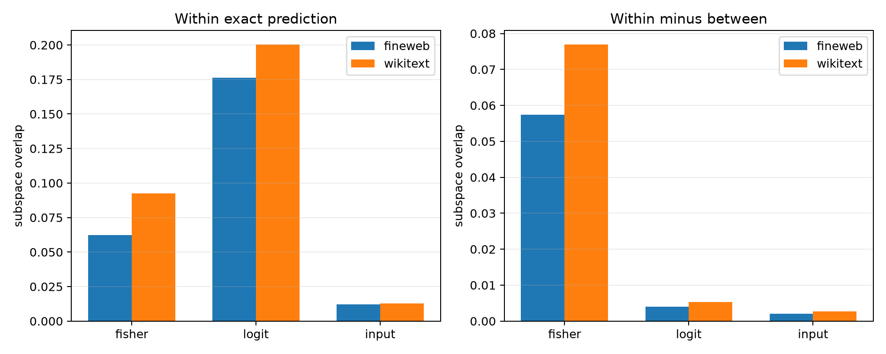

# Exact-prediction conditioning of local Layer-8 axes

Four prediction tokens were frozen after a count-only scan: ` the`, `.`, `,`, and newline. Eight sites per token and corpus were then selected without inspecting axes. The test asks whether the locally strongest causal subspaces recur after conditioning on the exact native top prediction.

## Locked hypotheses

- **E1_exact_prediction_improves_fisher_recurrence: supported.**
- **E2_exact_prediction_improves_logit_recurrence: not supported.**
- **E3_exact_prediction_improves_input_recurrence: not supported.**
- **E4_exact_prediction_stabilizes_token_labels: not supported.**
- **E5_input_verbs_transfer_cross_corpus: not supported.**
- **E6_input_recurrence_exceeds_random_subspaces: not supported.**

| Corpus | Comparison | Fisher overlap | Logit overlap | Input overlap | Token Jaccard |
|---|---|---:|---:|---:|---:|
| fineweb | within | 0.062 | 0.176 | 0.012 | 0.076 |
| fineweb | between | 0.005 | 0.172 | 0.010 | 0.017 |
| fineweb | advantage | 0.057 | 0.004 | 0.002 | 0.059 |
| wikitext | within | 0.093 | 0.200 | 0.013 | 0.106 |
| wikitext | between | 0.016 | 0.195 | 0.010 | 0.041 |
| wikitext | advantage | 0.077 | 0.005 | 0.003 | 0.065 |
| cross-corpus | same_prediction | 0.070 | 0.186 | 0.011 | 0.078 |
| cross-corpus | different_prediction | 0.009 | 0.183 | 0.010 | 0.032 |
| cross-corpus | advantage | 0.062 | 0.004 | 0.001 | 0.045 |

The random rank-4 input-subspace overlap expectation is `0.0078`. Prediction counts were fineweb: ` the`=74, `.`=55, `,`=39, `\n`=37; wikitext: ` the`=130, `.`=40, `,`=30, `\n`=40.

Exact output identity is a stronger conditioning variable than coarse token class, but any gain confined to Fisher/output coordinates can arise from the shared softmax readout. Recurrent internal verbs require input-subspace recurrence above the random baseline and cross-corpus transfer.
