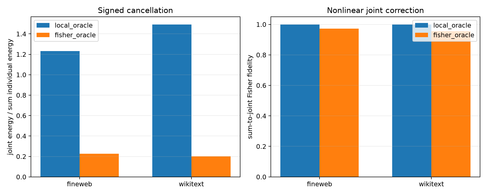

# Cancellation red-team for downstream-Fisher modes

For each frozen local or Fisher top-16 set, every mode is removed individually by 10% of its naturally present component. The same 16 input deltas are then applied jointly. This compares the sum of individual downstream effects with the exact joint forward pass, without renormalizing the joint input direction.

## Locked hypotheses

- **C1_fisher_individual_effects_cancel: supported.**
- **C2_exact_joint_effect_remains_cancelled: supported.**
- **C3_joint_nonlinearity_is_not_the_explanation: supported.**
- **C4_fisher_set_cancels_more_than_local_set: supported.**
- **C5_cancellation_is_ood_stable: supported.**

| Corpus | Route | Signed-sum energy / sum energies | Exact-joint energy / sum energies | Sum→joint fidelity/cosine | Joint KL / sum KL | Joint KL |
|---|---|---:|---:|---:|---:|---:|
| fineweb | local_oracle | 1.238 | 1.231 | 0.999/1.000 | 1.075 | 6.223e-05 |
| fineweb | fisher_oracle | 0.228 | 0.226 | 0.971/0.987 | 0.220 | 5.503e-05 |
| wikitext | local_oracle | 1.527 | 1.492 | 0.999/1.000 | 1.523 | 1.242e-04 |
| wikitext | fisher_oracle | 0.218 | 0.202 | 0.956/0.979 | 0.203 | 9.355e-05 |

A ratio below one means signed downstream effects cancel. It does not mean the modes are unnecessary: each was selected for a large individual effect. High sum-to-joint fidelity would locate the small joint effect in destructive addition rather than nonlinear failure of the individual-effect approximation.
