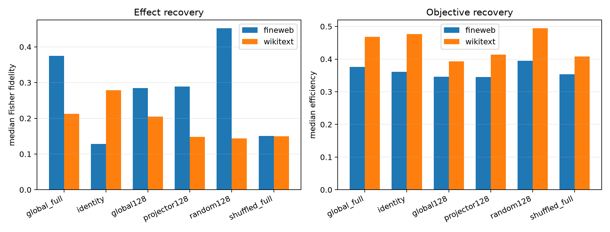

# Controls for the frozen suffix-Fisher metric

The failed global quotient is compared with a full Euclidean write metric, its learned rank-128 metric, the same rank-128 subspace without Fisher eigenvalue weights, a random rank-128 subspace, and a full basis with Fisher eigenvalues assigned to the wrong directions. Every metric selects a joint 16-mode program at the same input budget; the per-example Fisher program is used only as the target.

## Locked hypotheses

- **C1_global_fisher_beats_identity: not supported.**
- **C2_global128_beats_random128: not supported.**
- **C3_fisher_eigenvalues_add_value: not supported.**
- **C4_fisher_direction_weight_pairing_matters: not supported.**
- **C5_global_metric_is_not_only_generic_impact: not supported.**

| Corpus | Metric | Exact KL | Oracle fidelity/cosine | Objective efficiency | Support recall |
|---|---|---:|---:|---:|---:|
| fineweb | oracle | 7.117e-03 | 1.000/1.000 | 1.000 | 1.000 |
| fineweb | global_full | 1.871e-03 | 0.375/0.675 | 0.376 | 0.125 |
| fineweb | identity | 1.887e-03 | 0.128/0.496 | 0.361 | 0.062 |
| fineweb | global128 | 1.603e-03 | 0.285/0.544 | 0.346 | 0.125 |
| fineweb | projector128 | 1.856e-03 | 0.289/0.565 | 0.346 | 0.094 |
| fineweb | random128 | 1.770e-03 | 0.452/0.697 | 0.395 | 0.062 |
| fineweb | shuffled_full | 1.861e-03 | 0.151/0.622 | 0.354 | 0.062 |
| wikitext | oracle | 4.239e-03 | 1.000/1.000 | 1.000 | 1.000 |
| wikitext | global_full | 1.181e-03 | 0.213/0.506 | 0.468 | 0.062 |
| wikitext | identity | 1.186e-03 | 0.279/0.557 | 0.476 | 0.062 |
| wikitext | global128 | 1.166e-03 | 0.205/0.498 | 0.393 | 0.062 |
| wikitext | projector128 | 9.673e-04 | 0.148/0.421 | 0.413 | 0.062 |
| wikitext | random128 | 8.481e-04 | 0.144/0.392 | 0.495 | 0.062 |
| wikitext | shuffled_full | 9.472e-04 | 0.150/0.426 | 0.408 | 0.094 |

A learned metric only earns mechanistic credit here if it predicts the oracle's effect better than geometry-only controls. Large KL alone can come from a generic high-sensitivity direction with the wrong behavioral sign or token pattern.
