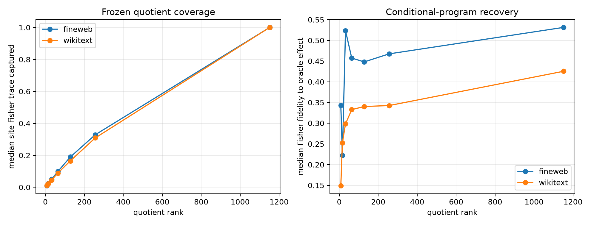

# Frozen low-rank suffix-Fisher quotient

A global suffix metric is learned from 64 disjoint FineWeb final-position states. Each state contributes exact-top-token plus sampled-tail score gradients with probability weights. SVD yields a frozen residual-space Fisher quotient. At evaluation, no suffix gradient is used by the frozen routes: the quotient is contracted with exact Layer-8 bilinear write tangents, and the same joint-Gram greedy selector chooses 16 modes. A per-example gradient oracle is computed only as an assessment target.

## Locked hypotheses

- **Q1_rank64_captures_site_fisher: not supported.**
- **Q2_rank64_recovers_half_oracle_effect: not supported.**
- **Q3_rank64_recovers_oracle_direction: not supported.**
- **Q4_rank128_is_near_full_frozen: supported.**
- **Q5_full_frozen_recovers_oracle_direction: not supported.**
- **Q6_rank128_ood_fidelity_is_stable: supported.**

| Corpus | Rank | Global spectrum energy | Site Fisher capture | Exact KL | KL/oracle | Oracle fidelity/cosine | Objective efficiency | Support recall |
|---|---:|---:|---:|---:|---:|---:|---:|---:|
| fineweb | 8 | 0.128 | 0.010 | 1.180e-03 | 0.163 | 0.343/0.680 | 0.225 | 0.062 |
| fineweb | 16 | 0.195 | 0.025 | 1.420e-03 | 0.196 | 0.222/0.567 | 0.286 | 0.094 |
| fineweb | 32 | 0.290 | 0.051 | 1.793e-03 | 0.247 | 0.524/0.776 | 0.392 | 0.125 |
| fineweb | 64 | 0.421 | 0.099 | 1.674e-03 | 0.231 | 0.457/0.723 | 0.487 | 0.125 |
| fineweb | 128 | 0.588 | 0.190 | 1.902e-03 | 0.262 | 0.448/0.700 | 0.481 | 0.125 |
| fineweb | 256 | 0.772 | 0.329 | 1.825e-03 | 0.252 | 0.467/0.812 | 0.514 | 0.125 |
| fineweb | full | 1.000 | 1.001 | 1.821e-03 | 0.251 | 0.531/0.777 | 0.509 | 0.094 |
| fineweb | per-example oracle | — | — | 7.247e-03 | 1.000 | 1.000/1.000 | 1.000 | 1.000 |
| wikitext | 8 | 0.128 | 0.011 | 1.634e-03 | 0.255 | 0.149/0.472 | 0.296 | 0.125 |
| wikitext | 16 | 0.195 | 0.023 | 2.315e-03 | 0.361 | 0.253/0.531 | 0.398 | 0.125 |
| wikitext | 32 | 0.290 | 0.046 | 2.895e-03 | 0.452 | 0.298/0.564 | 0.435 | 0.125 |
| wikitext | 64 | 0.421 | 0.089 | 2.846e-03 | 0.444 | 0.333/0.591 | 0.485 | 0.125 |
| wikitext | 128 | 0.588 | 0.165 | 3.093e-03 | 0.483 | 0.340/0.592 | 0.523 | 0.125 |
| wikitext | 256 | 0.772 | 0.309 | 3.115e-03 | 0.486 | 0.343/0.599 | 0.712 | 0.156 |
| wikitext | full | 1.000 | 1.001 | 2.643e-03 | 0.412 | 0.425/0.658 | 0.635 | 0.188 |
| wikitext | per-example oracle | — | — | 6.408e-03 | 1.000 | 1.000/1.000 | 1.000 | 1.000 |

High exact KL without oracle-effect fidelity would indicate a generic high-impact intervention, not recovery of the same conditional program. Conversely, low native support recall is compatible with success only if objective and finite-effect agreement survive, because the prior experiment showed effect-space equivalence can be more stable than mode identity.
