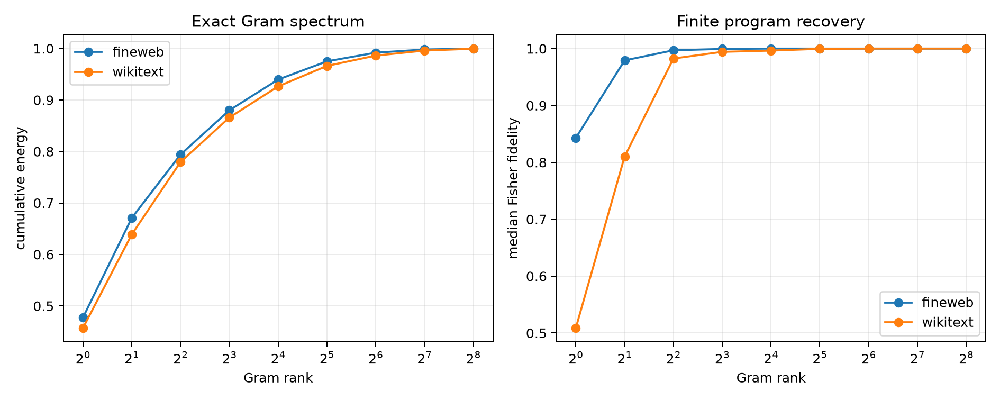

# Rank sweep for the exact state-conditioned Fisher Gram

For each state and output query, the full analytic tensor Jacobian defines an exact full-vocabulary softmax-Fisher response over 512 Layer-8 modes. Its 512×512 Gram is eigendecomposed, truncated, and used to select a joint 16-mode program. Each truncated program is then evaluated by an exact finite 5%-norm intervention through the full model.

## Locked hypotheses

- **R1_rank16_captures_gram_energy: supported.**
- **R2_rank16_recovers_finite_effect: supported.**
- **R3_rank16_recovers_objective: supported.**
- **R4_rank32_recovers_support: supported.**
- **R5_rank32_recovers_magnitude: supported.**
- **R6_compact_rank_is_ood_stable: supported.**

| Corpus | Rank | Gram energy | Exact KL | KL/full | Effect fidelity/cosine | Objective efficiency | Support recall |
|---|---:|---:|---:|---:|---:|---:|---:|
| fineweb | 1 | 0.477 | 3.337e-03 | 0.965 | 0.843/0.920 | 0.909 | 0.500 |
| fineweb | 2 | 0.671 | 3.523e-03 | 1.019 | 0.979/0.991 | 0.993 | 0.812 |
| fineweb | 4 | 0.794 | 3.427e-03 | 0.991 | 0.997/0.999 | 0.998 | 0.906 |
| fineweb | 8 | 0.880 | 3.459e-03 | 1.000 | 0.999/1.000 | 1.000 | 0.938 |
| fineweb | 16 | 0.940 | 3.464e-03 | 1.002 | 1.000/1.000 | 1.000 | 1.000 |
| fineweb | 32 | 0.975 | 3.458e-03 | 1.000 | 1.000/1.000 | 1.000 | 1.000 |
| fineweb | 64 | 0.992 | 3.458e-03 | 1.000 | 1.000/1.000 | 1.000 | 1.000 |
| fineweb | 128 | 0.998 | 3.458e-03 | 1.000 | 1.000/1.000 | 1.000 | 1.000 |
| fineweb | 256 | 1.000 | 3.458e-03 | 1.000 | 1.000/1.000 | 1.000 | 1.000 |
| fineweb | full | 1.000 | 3.458e-03 | 1.000 | 1.000/1.000 | 1.000 | 1.000 |
| wikitext | 1 | 0.457 | 5.687e-03 | 0.890 | 0.509/0.726 | 0.884 | 0.281 |
| wikitext | 2 | 0.639 | 5.788e-03 | 0.906 | 0.810/0.901 | 0.978 | 0.594 |
| wikitext | 4 | 0.780 | 6.263e-03 | 0.980 | 0.982/0.991 | 0.998 | 0.844 |
| wikitext | 8 | 0.866 | 6.399e-03 | 1.002 | 0.994/0.997 | 1.000 | 0.906 |
| wikitext | 16 | 0.926 | 6.399e-03 | 1.002 | 0.996/0.998 | 1.000 | 0.938 |
| wikitext | 32 | 0.966 | 6.399e-03 | 1.002 | 1.000/1.000 | 1.000 | 0.969 |
| wikitext | 64 | 0.986 | 6.399e-03 | 1.002 | 1.000/1.000 | 1.000 | 1.000 |
| wikitext | 128 | 0.996 | 6.388e-03 | 1.000 | 1.000/1.000 | 1.000 | 1.000 |
| wikitext | 256 | 1.000 | 6.388e-03 | 1.000 | 1.000/1.000 | 1.000 | 1.000 |
| wikitext | full | 1.000 | 6.388e-03 | 1.000 | 1.000/1.000 | 1.000 | 1.000 |

Gram energy, selected-program objective, finite behavioral magnitude, effect direction, and native support are different compression targets. A low-rank metric is useful only for the targets it actually preserves.
