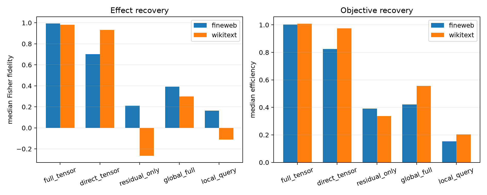

# Full analytic tensor Jacobian through Layers 9–17

This adds the exact final-position JVP of every squared-bilinear attention block to the residual/RMSNorm/bilinear-MLP interpreter. It differentiates QK-normalized `QK × Q2K2` routing, the current-layer value path, the fixed first-layer value bus, and the attention output projection. Causality keeps a final-token perturbation at the final position, so no earlier-position tangent state is required. The final unembedding Fisher metric remains exact over all 50,304 tokens.

## Locked hypotheses

- **A0_attention_jacobian_passes_small_finite_check: supported.**
- **A1_full_tensor_recovers_oracle_direction: supported.**
- **A2_full_tensor_recovers_oracle_magnitude: supported.**
- **A3_full_tensor_recovers_oracle_objective: supported.**
- **A4_attention_derivatives_close_ood_gap: not supported.**
- **A5_full_tangent_predicts_five_percent_edit: supported.**
- **A6_full_tensor_ood_stability: supported.**
- **A7_full_tensor_recovers_support: supported.**

| Corpus | Route | Exact KL | KL/oracle | Oracle fidelity/cosine | Objective efficiency | Support recall | Tangent→5% finite | Tangent→0.1% finite |
|---|---|---:|---:|---:|---:|---:|---:|---:|
| fineweb | oracle | 6.876e-03 | 1.000 | 1.000/1.000 | 1.000 | 1.000 | — | — |
| fineweb | full_tensor | 7.257e-03 | 1.055 | 0.994/0.997 | 1.002 | 0.875 | 0.984/0.997 | 1.000/1.000 |
| fineweb | direct_tensor | 4.122e-03 | 0.599 | 0.702/0.859 | 0.824 | 0.188 | 0.724/0.963 | — |
| fineweb | residual_only | 2.902e-03 | 0.422 | 0.210/0.538 | 0.391 | 0.062 | -2.160/0.357 | — |
| fineweb | global_full | 2.190e-03 | 0.318 | 0.391/0.648 | 0.422 | 0.094 | — | — |
| fineweb | local_query | 1.248e-03 | 0.181 | 0.163/0.507 | 0.152 | 0.062 | — | — |
| wikitext | oracle | 4.461e-03 | 1.000 | 1.000/1.000 | 1.000 | 1.000 | — | — |
| wikitext | full_tensor | 4.463e-03 | 1.000 | 0.983/0.991 | 1.008 | 0.844 | 0.986/0.997 | 1.000/1.000 |
| wikitext | direct_tensor | 3.726e-03 | 0.835 | 0.932/0.966 | 0.975 | 0.344 | 0.953/0.977 | — |
| wikitext | residual_only | 9.164e-04 | 0.205 | -0.266/0.086 | 0.336 | 0.031 | -2.655/0.624 | — |
| wikitext | global_full | 1.181e-03 | 0.265 | 0.300/0.626 | 0.556 | 0.062 | — | — |
| wikitext | local_query | 5.932e-04 | 0.133 | -0.112/0.173 | 0.204 | 0.062 | — | — |

The 0.1% check is a numerical validation of the analytic JVP. The 5% comparison additionally tests whether the tangent-selected program remains faithful under the finite intervention scale used throughout the causal experiments.
