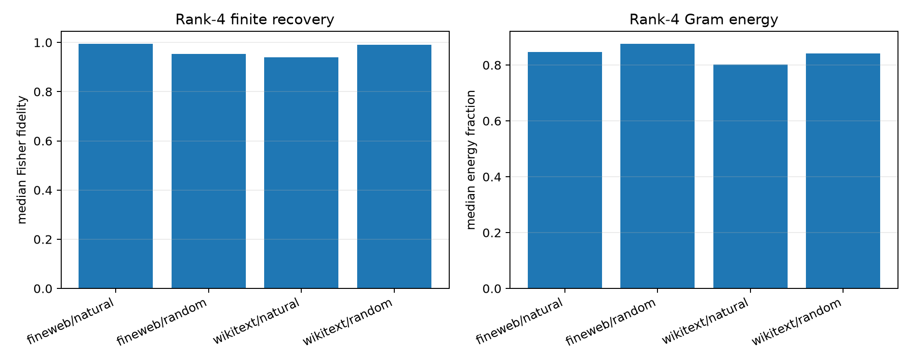

# Random-site and random-readout red-team of Gram compactness

The exact full tensor Jacobian is recomputed on uniformly sampled evaluation rows rather than high-query-score sites. Eight leading natural-write readouts are compared with eight seeded random orthonormal output readouts. Each readout defines its own Layer-8 interaction eigenmodes, but program selection and finite evaluation use the same full-vocabulary Fisher construction.

## Locked hypotheses

- **B1_rank4_survives_random_sites: not supported.**
- **B2_rank4_survives_random_readouts: supported.**
- **B3_rank16_is_universally_near_exact: supported.**
- **B4_high_score_selection_is_not_required: supported.**
- **B5_random_readouts_have_similar_gram_compactness: supported.**

| Corpus | Readout family | Rank | Gram energy | Exact KL | Effect fidelity/cosine | Objective efficiency | Support recall |
|---|---|---:|---:|---:|---:|---:|---:|
| fineweb | natural | 4 | 0.846 | 7.083e-03 | 0.995/0.997 | 0.998 | 0.938 |
| fineweb | natural | 16 | 0.963 | 6.448e-03 | 1.000/1.000 | 1.000 | 1.000 |
| fineweb | random | 4 | 0.876 | 6.596e-03 | 0.954/0.977 | 0.998 | 0.875 |
| fineweb | random | 16 | 0.962 | 6.719e-03 | 1.000/1.000 | 1.000 | 1.000 |
| wikitext | natural | 4 | 0.802 | 8.830e-03 | 0.939/0.969 | 0.996 | 0.812 |
| wikitext | natural | 16 | 0.925 | 9.062e-03 | 0.999/0.999 | 1.000 | 0.938 |
| wikitext | random | 4 | 0.841 | 7.399e-03 | 0.990/0.995 | 0.990 | 0.875 |
| wikitext | random | 16 | 0.949 | 8.868e-03 | 1.000/1.000 | 1.000 | 1.000 |

If random readouts are equally compact, rank 4 is best interpreted as a generic state-conditioned behavioral bottleneck. Semantic evidence would then need stable token/context labels or selective transfer, not spectral compactness itself.
