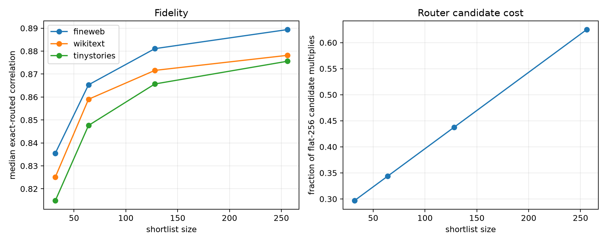

# Hierarchical layer-8 address router

A 64D coarse scan ranks all 512 candidate modes per query. Only the shortlisted modes receive the remaining 192 coordinates needed for a 256D refinement; 16 refined modes are selected. Exact routed scores evaluate those selected modes in the full 512D form. Candidate-projection multiply counts reuse the coarse partial dot products and exclude common state projection, top-k selection, and final selected-mode evaluation.

## Locked hypotheses

- **H1_shortlist64_matches_flat256: not supported.**
- **H2_shortlist64_is_predictive: not supported.**
- **H3_shortlist64_recovers_support: supported.**
- **H4_shortlist64_reduces_router_compute: supported.**
- **H5_shortlist128_nearly_equals_flat: not supported.**
- **H6_shortlist64_reduced_score_is_predictive: not supported.**

| Corpus | Shortlist | Exact corr./R² | Reduced corr./R² | Flat-256 corr. | Oracle corr. | Support recall | Router compute fraction |
|---|---:|---:|---:|---:|---:|---:|---:|
| fineweb | 32 | 0.836/0.693 | 0.781/0.600 | 0.896 | 0.931 | 0.500 | 0.297 |
| fineweb | 64 | 0.865/0.744 | 0.809/0.643 | 0.896 | 0.931 | 0.625 | 0.344 |
| fineweb | 128 | 0.881/0.771 | 0.825/0.668 | 0.896 | 0.931 | 0.625 | 0.438 |
| fineweb | 256 | 0.889/0.786 | 0.832/0.678 | 0.896 | 0.931 | 0.625 | 0.625 |
| wikitext | 32 | 0.825/0.670 | 0.777/0.593 | 0.886 | 0.927 | 0.500 | 0.297 |
| wikitext | 64 | 0.859/0.724 | 0.813/0.640 | 0.886 | 0.927 | 0.562 | 0.344 |
| wikitext | 128 | 0.872/0.744 | 0.825/0.657 | 0.886 | 0.927 | 0.625 | 0.438 |
| wikitext | 256 | 0.878/0.760 | 0.831/0.664 | 0.886 | 0.927 | 0.625 | 0.625 |
| tinystories | 32 | 0.815/0.657 | 0.754/0.555 | 0.884 | 0.925 | 0.500 | 0.297 |
| tinystories | 64 | 0.848/0.713 | 0.787/0.607 | 0.884 | 0.925 | 0.562 | 0.344 |
| tinystories | 128 | 0.866/0.744 | 0.804/0.633 | 0.884 | 0.925 | 0.625 | 0.438 |
| tinystories | 256 | 0.876/0.758 | 0.816/0.644 | 0.884 | 0.925 | 0.625 | 0.625 |

The compute fraction covers candidate projections, the part changed by hierarchical routing. It is not an end-to-end layer speedup: these 16 queries do not reconstruct the full MLP write, and state projection, top-k operations, selected-mode evaluation, memory traffic, and later transformer blocks remain.
