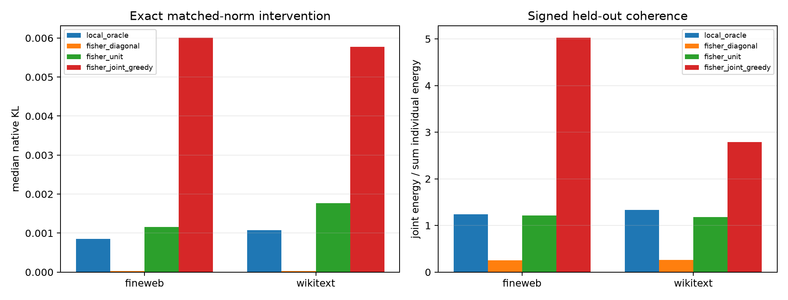

# Joint downstream-Fisher 16-mode program

The diagonal Fisher ranking ignores signed interactions and selected modes that cancel. This experiment greedily maximizes the full sketch-space Fisher energy of the signed joint mode effect per squared input-component norm. It compares that program with local query modes, natural-component Fisher diagonals, and per-unit-input Fisher diagonals. Selection uses one stratified sketch; all reported objectives use an independent sketch, and final KL is an exact finite forward pass at matched 5% input norm.

## Locked hypotheses

- **J1_joint_program_transfers_across_fisher_sketches: supported.**
- **J2_joint_program_is_constructive: supported.**
- **J3_joint_program_beats_diagonal_finite_effect: supported.**
- **J4_joint_program_beats_local_finite_effect: supported.**
- **J5_local_program_retains_query_advantage: not supported.**
- **J6_joint_support_is_recurrent: not supported.**
- **J7_joint_program_does_not_require_extreme_amplification: supported.**

| Corpus | Route | Exact KL | |query effect| | Held-out normalized Fisher objective | Held-out coherence | Local support | Raw projection norm | Applied scale |
|---|---|---:|---:|---:|---:|---:|---:|---:|
| fineweb | local_oracle | 8.500e-04 | 2.832e+02 | 5.969e-04 | 1.244 | 1.000 | 1.439e-01 | 0.35 |
| fineweb | fisher_diagonal | 2.767e-05 | 3.532e+01 | 2.135e-05 | 0.250 | 0.312 | 9.366e-01 | 0.05 |
| fineweb | fisher_unit | 1.154e-03 | 2.381e+02 | 8.881e-04 | 1.217 | 0.219 | 8.514e-02 | 0.59 |
| fineweb | fisher_joint_greedy | 6.009e-03 | 1.626e+02 | 4.819e-03 | 5.027 | 0.062 | 6.931e-02 | 0.72 |
| fineweb | greedy recurrence | — | — | efficiency 0.968 | support recall 0.750; effect cosine 0.992; input cosine 0.840 | — | — | — |
| wikitext | local_oracle | 1.079e-03 | 2.625e+02 | 8.968e-04 | 1.333 | 1.000 | 1.591e-01 | 0.31 |
| wikitext | fisher_diagonal | 3.079e-05 | 3.704e+01 | 1.886e-05 | 0.262 | 0.312 | 9.278e-01 | 0.05 |
| wikitext | fisher_unit | 1.763e-03 | 1.666e+02 | 1.375e-03 | 1.177 | 0.219 | 9.418e-02 | 0.53 |
| wikitext | fisher_joint_greedy | 5.770e-03 | 9.672e+01 | 3.888e-03 | 2.789 | 0.094 | 6.784e-02 | 0.74 |
| wikitext | greedy recurrence | — | — | efficiency 0.904 | support recall 0.406; effect cosine 0.954; input cosine 0.699 | — | — | — |

The greedy program is an intervention-budget optimizer, not a semantic decomposition. A successful joint Fisher program can be useful for finding behaviorally coherent causal directions while remaining a poor explanation of the specified local tensor query.

Support recurrence, input-direction recurrence, and downstream-effect recurrence answer different identifiability questions. High held-out objective efficiency with low support overlap means several mode sets may implement comparably strong downstream interventions; it does not identify a unique native circuit.
