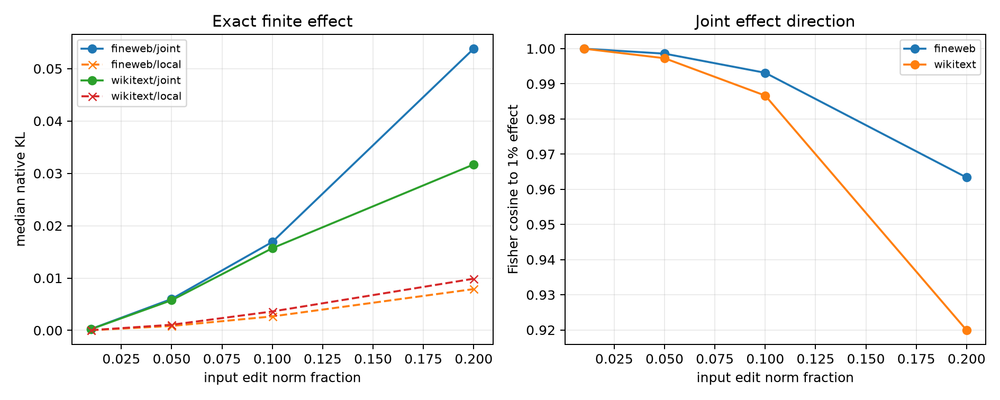

# Scale red-team for the joint Fisher program

The frozen per-example mode sets from the 5%-norm joint-Fisher experiment are rerun at 1%, 5%, 10%, and 20% input norm. No mode selection or Fisher estimation is repeated at the new scales.

## Locked hypotheses

- **S1_joint_advantage_is_not_a_single_scale_artifact: supported.**
- **S2_joint_effect_direction_is_scale_stable: supported.**
- **S3_joint_program_beats_unit_diagonal: supported.**
- **S4_joint_effect_is_monotonic: supported.**
- **S5_local_query_tradeoff_persists: supported.**

| Corpus | Scale | Local KL | Diagonal KL | Unit-diagonal KL | Joint KL | Joint/local | Joint effect cosine to 1% | Local/joint query effect |
|---|---:|---:|---:|---:|---:|---:|---:|---:|
| fineweb | 0.01 | 3.777e-05 | 1.247e-06 | 5.573e-05 | 2.715e-04 | 7.19× | 1.000 | 1.49× |
| fineweb | 0.05 | 8.500e-04 | 2.767e-05 | 1.154e-03 | 6.009e-03 | 7.07× | 0.999 | 1.74× |
| fineweb | 0.10 | 2.674e-03 | 1.077e-04 | 3.854e-03 | 1.690e-02 | 6.32× | 0.993 | 2.47× |
| fineweb | 0.20 | 7.893e-03 | 4.176e-04 | 1.232e-02 | 5.381e-02 | 6.82× | 0.963 | 2.61× |
| wikitext | 0.01 | 4.907e-05 | 1.334e-06 | 8.304e-05 | 2.463e-04 | 5.02× | 1.000 | 1.77× |
| wikitext | 0.05 | 1.079e-03 | 3.079e-05 | 1.763e-03 | 5.770e-03 | 5.35× | 0.997 | 2.71× |
| wikitext | 0.10 | 3.618e-03 | 1.218e-04 | 5.456e-03 | 1.571e-02 | 4.34× | 0.987 | 2.82× |
| wikitext | 0.20 | 9.874e-03 | 4.793e-04 | 1.236e-02 | 3.170e-02 | 3.21× | 0.920 | 2.00× |

This checks finite-scale robustness at the same states. It does not turn the per-example oracle into a reusable router or prove semantic coherence.
