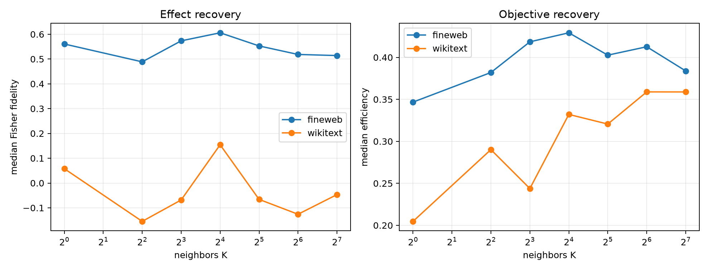

# State-conditioned KNN suffix-Fisher metric

A bank of 128 disjoint FineWeb Layer-8 states stores stratified suffix-Fisher gradients. States are centered, projected into a frozen 64D PCA space, and cosine-normalized. At evaluation, the current Layer-8 state retrieves K neighbors; their metrics are pooled and contracted with exact bilinear write tangents. No evaluation-time suffix gradient is used for KNN selection. The per-example gradient program is computed only as the target.

## Locked hypotheses

- **K1_eight_neighbors_recovers_effect: not supported.**
- **K2_eight_neighbors_beats_global: not supported.**
- **K3_eight_neighbors_recovers_objective: not supported.**
- **K4_eight_neighbor_ood_stability: not supported.**
- **K5_some_frozen_knn_metric_recovers_effect: not supported.**
- **K6_nearest_metric_is_better_than_all_data: not supported.**

Post-hoc best common K by worst-corpus fidelity: **16**.

| Corpus | Metric | Exact KL | Oracle fidelity/cosine | Objective efficiency | Support recall |
|---|---|---:|---:|---:|---:|
| fineweb | oracle | 6.347e-03 | 1.000/1.000 | 1.000 | 1.000 |
| fineweb | global_full | 2.171e-03 | 0.539/0.881 | 0.386 | 0.062 |
| fineweb | knn_1 | 1.988e-03 | 0.561/0.802 | 0.347 | 0.062 |
| fineweb | knn_4 | 2.092e-03 | 0.489/0.807 | 0.382 | 0.062 |
| fineweb | knn_8 | 2.223e-03 | 0.573/0.861 | 0.419 | 0.062 |
| fineweb | knn_16 | 2.441e-03 | 0.606/0.881 | 0.429 | 0.062 |
| fineweb | knn_32 | 2.296e-03 | 0.553/0.891 | 0.403 | 0.062 |
| fineweb | knn_64 | 2.175e-03 | 0.519/0.872 | 0.413 | 0.062 |
| fineweb | knn_128 | 2.125e-03 | 0.514/0.872 | 0.384 | 0.062 |
| fineweb | nearest-state diagnostic | — | cosine 0.526 | — | — |
| wikitext | oracle | 4.380e-03 | 1.000/1.000 | 1.000 | 1.000 |
| wikitext | global_full | 1.318e-03 | 0.056/0.360 | 0.329 | 0.062 |
| wikitext | knn_1 | 1.268e-03 | 0.058/0.357 | 0.205 | 0.062 |
| wikitext | knn_4 | 1.035e-03 | -0.155/0.193 | 0.290 | 0.062 |
| wikitext | knn_8 | 1.059e-03 | -0.068/0.275 | 0.244 | 0.000 |
| wikitext | knn_16 | 1.466e-03 | 0.154/0.443 | 0.332 | 0.062 |
| wikitext | knn_32 | 1.367e-03 | -0.066/0.301 | 0.321 | 0.062 |
| wikitext | knn_64 | 1.471e-03 | -0.126/0.315 | 0.359 | 0.062 |
| wikitext | knn_128 | 1.439e-03 | -0.047/0.287 | 0.359 | 0.000 |
| wikitext | nearest-state diagnostic | — | cosine 0.559 | — | — |

KNN success would show that suffix geometry is locally reusable in Layer-8 state space. Failure would not prove unpredictability: this router uses only Euclidean neighborhood structure in a 64D state PCA and a small FineWeb bank.
