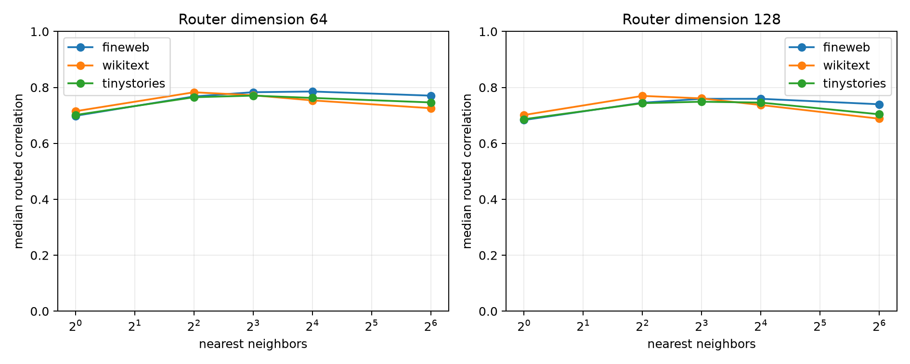

# Nearest-context router for layer-8 modes

FineWeb discovery examples form a nonparametric route memory. For each evaluation state, nearest neighbors in standardized state-SVD coordinates vote by mean absolute mode contribution; the resulting top 16 modes are then evaluated exactly. The preregistered router uses 128 coordinates and 8 neighbors. Other dimensions and neighbor counts are exploratory diagnostics.

## Locked hypotheses

- **K1_primary_knn_is_predictive: not supported.**
- **K2_primary_knn_beats_quadratic: not supported.**
- **K3_primary_knn_approaches_oracle: not supported.**
- **K4_primary_knn_recovers_support: not supported.**
- **K5_primary_knn_transfers_ood: supported.**

| Corpus | State dim | Neighbors | Routed corr./R² | Oracle corr. | Support recall | Abs. mass | Quadratic-128 corr. |
|---|---:|---:|---:|---:|---:|---:|---:|
| fineweb | 64 | 1 | 0.699/0.483 | 0.931 | 0.250 | 0.144 | 0.847 |
| fineweb | 64 | 4 | 0.768/0.584 | 0.931 | 0.375 | 0.176 | 0.847 |
| fineweb | 64 | 8 | 0.783/0.606 | 0.931 | 0.375 | 0.185 | 0.847 |
| fineweb | 64 | 16 | 0.785/0.606 | 0.931 | 0.375 | 0.188 | 0.847 |
| fineweb | 64 | 64 | 0.771/0.584 | 0.931 | 0.375 | 0.184 | 0.847 |
| fineweb | 128 | 1 | 0.683/0.464 | 0.931 | 0.250 | 0.143 | 0.847 |
| fineweb | 128 | 4 | 0.745/0.550 | 0.931 | 0.312 | 0.174 | 0.847 |
| fineweb | 128 | 8 | 0.759/0.569 | 0.931 | 0.375 | 0.180 | 0.847 |
| fineweb | 128 | 16 | 0.759/0.567 | 0.931 | 0.312 | 0.181 | 0.847 |
| fineweb | 128 | 64 | 0.740/0.536 | 0.931 | 0.312 | 0.174 | 0.847 |
| wikitext | 64 | 1 | 0.715/0.495 | 0.927 | 0.250 | 0.135 | 0.829 |
| wikitext | 64 | 4 | 0.783/0.594 | 0.927 | 0.312 | 0.167 | 0.829 |
| wikitext | 64 | 8 | 0.772/0.581 | 0.927 | 0.375 | 0.175 | 0.829 |
| wikitext | 64 | 16 | 0.754/0.556 | 0.927 | 0.375 | 0.178 | 0.829 |
| wikitext | 64 | 64 | 0.726/0.512 | 0.927 | 0.312 | 0.175 | 0.829 |
| wikitext | 128 | 1 | 0.701/0.478 | 0.927 | 0.250 | 0.135 | 0.829 |
| wikitext | 128 | 4 | 0.770/0.570 | 0.927 | 0.312 | 0.164 | 0.829 |
| wikitext | 128 | 8 | 0.761/0.550 | 0.927 | 0.312 | 0.170 | 0.829 |
| wikitext | 128 | 16 | 0.737/0.531 | 0.927 | 0.312 | 0.171 | 0.829 |
| wikitext | 128 | 64 | 0.688/0.463 | 0.927 | 0.312 | 0.166 | 0.829 |
| tinystories | 64 | 1 | 0.701/0.487 | 0.925 | 0.250 | 0.142 | 0.822 |
| tinystories | 64 | 4 | 0.765/0.578 | 0.925 | 0.312 | 0.174 | 0.822 |
| tinystories | 64 | 8 | 0.771/0.584 | 0.925 | 0.375 | 0.181 | 0.822 |
| tinystories | 64 | 16 | 0.762/0.568 | 0.925 | 0.375 | 0.183 | 0.822 |
| tinystories | 64 | 64 | 0.746/0.540 | 0.925 | 0.312 | 0.179 | 0.822 |
| tinystories | 128 | 1 | 0.686/0.470 | 0.925 | 0.250 | 0.142 | 0.822 |
| tinystories | 128 | 4 | 0.744/0.545 | 0.925 | 0.312 | 0.171 | 0.822 |
| tinystories | 128 | 8 | 0.749/0.551 | 0.925 | 0.312 | 0.176 | 0.822 |
| tinystories | 128 | 16 | 0.746/0.547 | 0.925 | 0.312 | 0.177 | 0.822 |
| tinystories | 128 | 64 | 0.704/0.481 | 0.925 | 0.312 | 0.168 | 0.822 |

Nearest-context routing is a predictability diagnostic, not a compact mechanism: it stores the discovery contribution table and performs retrieval. The preregistered router fails every fidelity/support gate except OOD stability, and the exploratory grid remains well below the oracle. Coarse or local similarity in up to 128 leading state coordinates therefore does not recover the adaptive route in this test.
