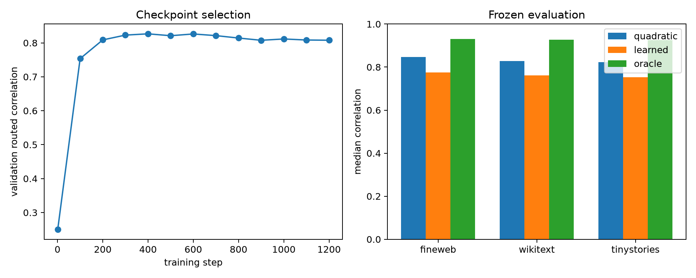

# Supervised nonlinear router for layer-8 modes

A two-layer GELU router maps 128 standardized state coordinates to 16×512 support logits. It is trained on 80% of the FineWeb discovery positions with weighted multilabel BCE, selected only by routed-score correlation on the remaining 20%, then frozen for all evaluation corpora. Selected modes are evaluated exactly, so this is an information/predictability test rather than an efficient replacement.

## Locked hypotheses

- **L1_learned_router_is_predictive: not supported.**
- **L2_learned_router_beats_quadratic: not supported.**
- **L3_learned_router_approaches_oracle: not supported.**
- **L4_learned_router_recovers_support: not supported.**
- **L5_learned_router_transfers_ood: supported.**
- **L6_validation_predicts_test: not supported.**

Router parameters: **2,138,368**; best validation step: **400**; validation correlation: **0.827**.

| Corpus | Learned corr./R² | Quadratic-128 corr. | Oracle corr. | Support recall | Abs. mass |
|---|---:|---:|---:|---:|---:|
| fineweb | 0.775/0.590 | 0.847 | 0.931 | 0.312 | 0.173 |
| wikitext | 0.762/0.552 | 0.829 | 0.927 | 0.312 | 0.164 |
| tinystories | 0.753/0.554 | 0.822 | 0.925 | 0.312 | 0.164 |

The router is deliberately overpowered as a predictability probe. Its parameter count and dense 16×512 logits must be counted; even a successful result would show that route identity is learnable from 128D context, not that the resulting explanation is shorter or cheaper than the native computation.
