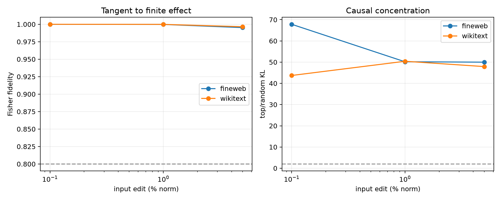

# Finite validation of local Layer-8 behavioral axes

The basis-invariant Jacobian's four leading right-singular directions are edited directly in the normalized Layer-8 MLP input. Full nonlinear MLP and suffix computation is rerun. Seeded random directions in the same 512D state basis provide matched-norm controls. These are local off-manifold sensitivity tests, not claims that the edit is a natural language counterfactual.

## Locked hypotheses

- **D1_tangent_is_exact_at_point_one_percent: supported.**
- **D2_tangent_remains_faithful_at_one_percent: supported.**
- **D3_tangent_is_useful_at_five_percent: supported.**
- **D4_axis_token_signs_validate: supported.**
- **D5_top_axes_beat_random_directions: supported.**

| Corpus | Edit | Fidelity / cosine | Top KL | Random KL | KL ratio | Token-sign agreement |
|---|---:|---:|---:|---:|---:|---:|
| fineweb | 0.1% | 1.000 / 1.000 | 5.901e-06 | 8.698e-08 | 67.8x | 1.000 |
| fineweb | 1.0% | 1.000 / 1.000 | 5.982e-04 | 1.192e-05 | 50.2x | 1.000 |
| fineweb | 5.0% | 0.995 / 0.998 | 1.497e-02 | 2.995e-04 | 50.0x | 1.000 |
| wikitext | 0.1% | 1.000 / 1.000 | 1.159e-05 | 2.651e-07 | 43.7x | 1.000 |
| wikitext | 1.0% | 1.000 / 1.000 | 1.189e-03 | 2.359e-05 | 50.4x | 1.000 |
| wikitext | 5.0% | 0.997 / 0.999 | 3.110e-02 | 6.491e-04 | 47.9x | 1.000 |

The test distinguishes two questions: whether local axes are finite-causally real, and whether the same axes recur globally. The former can succeed even though the preceding recurrence audit failed.
