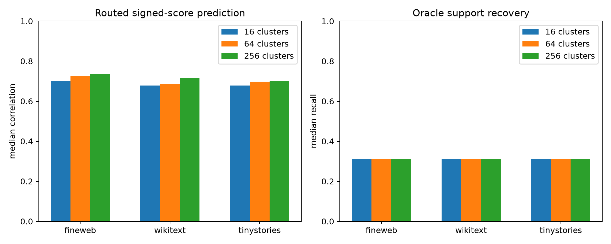

# Frozen context router for layer-8 interaction modes

A router is fit only on FineWeb discovery states. Standardized state-SVD-64 coordinates are clustered; each cluster stores the modes with highest mean absolute contribution for each of 16 natural output queries. At evaluation time, cluster assignment chooses a frozen route without observing realized mode contributions. Scores then use the selected exact modes. Fixed spectral, corpus-average, and oracle per-token subsets are matched-budget controls.

## Locked hypotheses

- **R1_cluster64_routes_are_predictive: not supported.**
- **R2_routing_beats_fixed_spectrum: not supported.**
- **R3_cluster256_approaches_oracle: not supported.**
- **R4_router_transfers_ood: supported.**
- **R5_router_predicts_support: not supported.**
- **R6_routes_use_a_broad_dictionary: not supported.**

### Budget 16

| Corpus | Clusters | Fixed corr. | Global-average corr. | Routed corr./R² | Oracle corr. | Support recall | Abs. mass | Route union |
|---|---:|---:|---:|---:|---:|---:|---:|---:|
| fineweb | 16 | 0.649 | 0.630 | 0.699/0.477 | 0.931 | 0.312 | 0.167 | 46 |
| fineweb | 64 | 0.649 | 0.630 | 0.727/0.523 | 0.931 | 0.312 | 0.171 | 102 |
| fineweb | 256 | 0.649 | 0.630 | 0.735/0.536 | 0.931 | 0.312 | 0.171 | 198 |
| wikitext | 16 | 0.604 | 0.601 | 0.678/0.447 | 0.927 | 0.312 | 0.162 | 46 |
| wikitext | 64 | 0.604 | 0.601 | 0.686/0.468 | 0.927 | 0.312 | 0.164 | 102 |
| wikitext | 256 | 0.604 | 0.601 | 0.717/0.488 | 0.927 | 0.312 | 0.164 | 198 |
| tinystories | 16 | 0.622 | 0.612 | 0.678/0.446 | 0.925 | 0.312 | 0.163 | 46 |
| tinystories | 64 | 0.622 | 0.612 | 0.697/0.475 | 0.925 | 0.312 | 0.165 | 102 |
| tinystories | 256 | 0.622 | 0.612 | 0.700/0.487 | 0.925 | 0.312 | 0.164 | 198 |

The routed score uses exact selected mode projections, so this tests support prediction rather than total execution cost. A practical compiled router must include state projection, nearest-centroid lookup, and sparse mode evaluation, and still needs finite-intervention validation.
