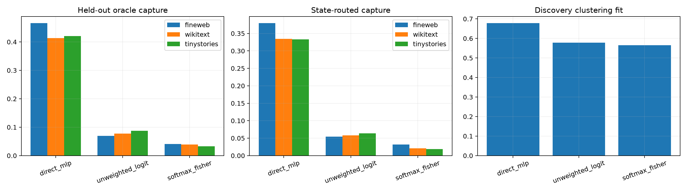

# Multimetric localization of Layer-8 nonquantizability

The same native Layer-8 state basis and 64-prototype budget are applied separately to the direct MLP write Jacobian, the full unweighted suffix-logit Jacobian, and the softmax-Fisher-weighted suffix Jacobian. This locates whether local-axis variability originates in the tensor layer, downstream transport/readout, or probability geometry.

## Locked hypotheses

- **T1_direct_tensor_axes_are_quantizable: supported.**
- **T2_unweighted_logit_axes_are_quantizable: not supported.**
- **T3_fisher_axes_remain_nonquantizable: supported.**
- **T4_downstream_geometry_creates_variability: supported.**
- **T5_native_state_routes_direct_axes: supported.**
- **T6_metric_regime_transfers: supported.**

| Corpus | Metric | Training similarity | Oracle capture | Routed capture | Route match |
|---|---|---:|---:|---:|---:|
| fineweb | direct_mlp | 0.678 | 0.466 | 0.379 | 0.281 |
| fineweb | unweighted_logit | 0.578 | 0.070 | 0.054 | 0.188 |
| fineweb | softmax_fisher | 0.565 | 0.041 | 0.032 | 0.188 |
| wikitext | direct_mlp | 0.678 | 0.413 | 0.334 | 0.188 |
| wikitext | unweighted_logit | 0.578 | 0.078 | 0.058 | 0.312 |
| wikitext | softmax_fisher | 0.565 | 0.040 | 0.021 | 0.031 |
| tinystories | direct_mlp | 0.678 | 0.421 | 0.333 | 0.188 |
| tinystories | unweighted_logit | 0.578 | 0.088 | 0.064 | 0.344 |
| tinystories | softmax_fisher | 0.565 | 0.033 | 0.019 | 0.188 |

Cross-metric same-site overlaps are included in JSON. If direct axes quantize but Fisher axes do not, downstream geometry creates the continuous regime. If all fail, the native bilinear Jacobian itself varies continuously with state.
