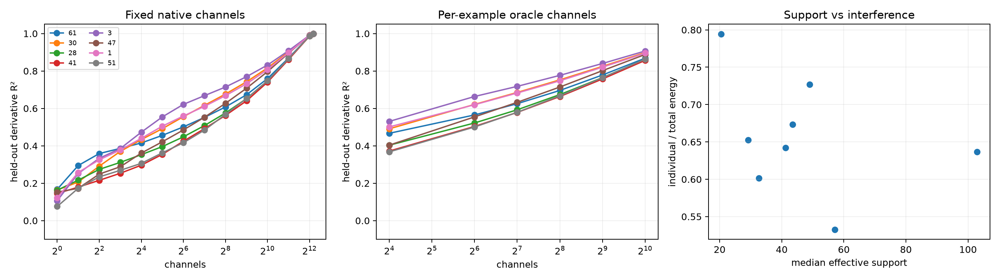

# Native-channel programs for routed Layer-8 addresses

Each fixed four-dimensional address is expanded in the exact native bilinear CP terms. A fixed channel ordering is learned only from training contexts; a per-example oracle selects channels by their individual derivative-write energy. The latter diagnoses conditional sparsity and is not a deployable router. Summed individual energy divided by total write energy measures cooperation (<1) or cancellation (>1).

## Locked hypotheses

- **C1_native_channel_sum_is_exact: supported.**
- **C2_static_512_is_sufficient: not supported.**
- **C3_oracle_256_is_sufficient: not supported.**
- **C4_context_selection_matters: not supported.**
- **C5_native_ranking_beats_random: supported.**
- **C6_channel_program_is_sparse: supported.**
- **C7_channels_interfere: supported.**

| Address | Static K90 | Static R² @256 / 512 | Oracle R² @256 | Effective support | Individual/total energy | Random-512 p95 |
|---:|---:|---:|---:|---:|---:|---:|
| 61 | 4096 | 0.608 / 0.673 | 0.696 | 20.5 | 0.794 | 0.216 |
| 30 | 2048 | 0.677 / 0.742 | 0.753 | 29.2 | 0.652 | 0.142 |
| 28 | 4096 | 0.576 / 0.652 | 0.674 | 49.0 | 0.727 | 0.147 |
| 41 | 4096 | 0.563 / 0.640 | 0.664 | 43.5 | 0.673 | 0.255 |
| 3 | 2048 | 0.714 / 0.770 | 0.777 | 32.6 | 0.602 | 0.225 |
| 47 | 4096 | 0.627 / 0.708 | 0.714 | 57.1 | 0.533 | 0.166 |
| 1 | 4096 | 0.668 / 0.732 | 0.748 | 41.2 | 0.642 | 0.349 |
| 51 | 4096 | 0.568 / 0.653 | 0.667 | 103.0 | 0.637 | 0.192 |

A compact static program would support native neuron-aligned modules. A compact oracle but broad static program would instead support context-dependent computation in superposition. If both remain broad, the native CP basis is not a short description of the complete derivative write.
