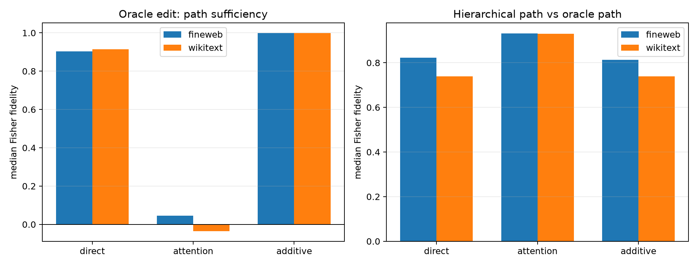

# Layer-8 → Layer-9 direct and attention path decomposition

A routed layer-8 MLP input edit changes the layer-8 write. At layer 9, the `direct` hybrid changes the residual/mixed input while clamping the native attention write; the `attention` hybrid changes the attention write while clamping the native mixed input. Layer-9 MLP computation is recomputed in both hybrids, and each hybrid is propagated through layers 10–17 and the unembedding. `Additive` is the sum of the two final-logit effects and is not itself a finite forward pass.

The first-layer value bus is unchanged by a layer-8 MLP edit in this architecture, so it is held exactly fixed rather than assigned to either path.

## Locked hypotheses

- **P1_additive_paths_explain_full: supported.**
- **P2_no_single_path_is_sufficient: not supported.**
- **P3_immediate_interaction_is_small: supported.**
- **P4_hierarchical_error_is_attention_heavy: not supported.**
- **P5_flat_improves_both_paths: supported.**

## Within-route decomposition

| Corpus | Route | Direct fidelity (KL/full) | Attention fidelity (KL/full) | Additive fidelity | Layer-9 interaction energy | Full native KL |
|---|---|---:|---:|---:|---:|---:|
| fineweb | oracle | 0.903 (0.960) | 0.045 (0.093) | 1.000 | 9.283e-05 | 8.218e-04 |
| fineweb | flat256 | 0.903 (0.942) | 0.041 (0.090) | 1.000 | 5.898e-05 | 6.803e-04 |
| fineweb | hierarchical128 | 0.918 (0.964) | 0.030 (0.074) | 1.000 | 5.086e-05 | 5.477e-04 |
| wikitext | oracle | 0.914 (1.034) | -0.036 (0.081) | 0.999 | 1.025e-04 | 5.119e-04 |
| wikitext | flat256 | 0.935 (1.012) | -0.016 (0.062) | 1.000 | 3.939e-05 | 2.866e-04 |
| wikitext | hierarchical128 | 0.928 (0.994) | -0.006 (0.066) | 1.000 | 2.204e-05 | 2.137e-04 |

## Each routed path compared with the oracle path

| Corpus | Route | Direct | Attention | Additive | Full |
|---|---|---:|---:|---:|---:|
| fineweb | flat256 | 0.836 | 0.942 | 0.827 | 0.828 |
| fineweb | hierarchical128 | 0.822 | 0.931 | 0.813 | 0.814 |
| wikitext | flat256 | 0.827 | 0.941 | 0.808 | 0.813 |
| wikitext | hierarchical128 | 0.739 | 0.930 | 0.738 | 0.740 |

These are hybrid path-specific causal effects, not percentages of information stored in attention or the MLP. Later nonlinearities mean direct and attention effects need not add, which is precisely what the additive fidelity tests.

The parenthesized KL/full values compare each hybrid's exact KL from the native distribution with the full edit's KL. KL ratios are magnitude diagnostics, not an additive allocation: direct and attention changes can cooperate or oppose one another.
