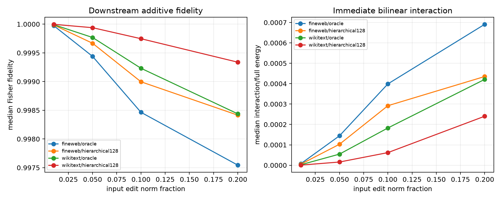

# Scale red-team of the Layer-8 → Layer-9 path split

The same direct/attention hybrids are evaluated at input-edit norms of 1%, 5%, 10%, and 20%. Sites and routes are reselected deterministically from the same frozen evaluation panels at every scale. Two high-score sites per each of 16 queries are used per corpus.

## Locked hypotheses

- **S1_local_additivity: supported.**
- **S2_additivity_survives_ten_percent: supported.**
- **S3_direct_path_survives_ten_percent: supported.**
- **S4_twenty_percent_exposes_nonlinearity: not supported.**
- **S5_attention_route_match_is_scale_stable: not supported.**

| Scale | Corpus | Route | Direct fidelity | Additive fidelity | Layer-9 interaction energy | Attention route→oracle | Full route→oracle |
|---:|---|---|---:|---:|---:|---:|---:|
| 0.01 | fineweb | oracle | 0.926 | 1.000 | 7.335e-06 | 1.000 | 1.000 |
| 0.01 | fineweb | hierarchical128 | 0.923 | 1.000 | 5.102e-06 | 0.944 | 0.829 |
| 0.01 | wikitext | oracle | 0.950 | 1.000 | 2.419e-06 | 1.000 | 1.000 |
| 0.01 | wikitext | hierarchical128 | 0.958 | 1.000 | 6.516e-07 | 0.858 | 0.575 |
| 0.05 | fineweb | oracle | 0.927 | 0.999 | 1.444e-04 | 1.000 | 1.000 |
| 0.05 | fineweb | hierarchical128 | 0.926 | 1.000 | 1.029e-04 | 0.936 | 0.830 |
| 0.05 | wikitext | oracle | 0.949 | 1.000 | 5.456e-05 | 1.000 | 1.000 |
| 0.05 | wikitext | hierarchical128 | 0.956 | 1.000 | 1.578e-05 | 0.858 | 0.583 |
| 0.10 | fineweb | oracle | 0.932 | 0.998 | 3.989e-04 | 1.000 | 1.000 |
| 0.10 | fineweb | hierarchical128 | 0.938 | 0.999 | 2.919e-04 | 0.916 | 0.808 |
| 0.10 | wikitext | oracle | 0.946 | 0.999 | 1.828e-04 | 1.000 | 1.000 |
| 0.10 | wikitext | hierarchical128 | 0.958 | 1.000 | 6.194e-05 | 0.857 | 0.598 |
| 0.20 | fineweb | oracle | 0.949 | 0.998 | 6.910e-04 | 1.000 | 1.000 |
| 0.20 | fineweb | hierarchical128 | 0.962 | 0.998 | 4.350e-04 | 0.807 | 0.691 |
| 0.20 | wikitext | oracle | 0.943 | 0.998 | 4.210e-04 | 1.000 | 1.000 |
| 0.20 | wikitext | hierarchical128 | 0.960 | 0.999 | 2.403e-04 | 0.801 | 0.545 |

At larger scales, additive failure can arise both from the bilinear cross term inside layer 9 and from nonlinear propagation through later normalization, attention, MLPs, and the bounded-logit transform. This experiment does not assign those later interactions to a unique layer.
