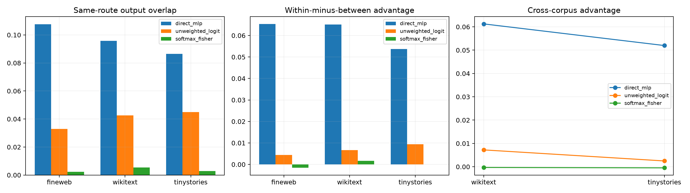

# Output-role consistency of routed Layer-8 prototypes

The frozen state router selects one of 64 direct-input prototypes. For every selected prototype and context, its four directions are propagated through the local MLP Jacobian, unweighted suffix-logit Jacobian, and softmax-Fisher response. Output subspaces are compared within versus across route labels, including FineWeb-to-OOD pairs.

## Locked hypotheses

- **V1_same_route_has_stable_direct_write_role: not supported.**
- **V2_route_explains_direct_output_recurrence: not supported.**
- **V3_same_route_logit_role_recurs: not supported.**
- **V4_same_route_fisher_role_recurs: not supported.**
- **V5_direct_role_transfers_cross_corpus: not supported.**
- **V6_suffix_reduces_recurrence: not supported.**

| Corpus | Metric | Same/different overlap | Advantage | Pairs |
|---|---|---:|---:|---:|
| fineweb | direct_mlp | 0.108/0.042 | 0.065 | 768 |
| fineweb | unweighted_logit | 0.033/0.028 | 0.004 | 768 |
| fineweb | softmax_fisher | 0.002/0.004 | -0.002 | 768 |
| wikitext | direct_mlp | 0.096/0.031 | 0.065 | 768 |
| wikitext | unweighted_logit | 0.043/0.036 | 0.007 | 768 |
| wikitext | softmax_fisher | 0.005/0.004 | 0.002 | 768 |
| tinystories | direct_mlp | 0.087/0.033 | 0.054 | 768 |
| tinystories | unweighted_logit | 0.045/0.036 | 0.009 | 768 |
| tinystories | softmax_fisher | 0.003/0.003 | 0.000 | 768 |

| Cross-corpus | Metric | Same/different overlap | Advantage |
|---|---|---:|---:|
| FineWeb→wikitext | direct_mlp | 0.095/0.034 | 0.061 |
| FineWeb→wikitext | unweighted_logit | 0.037/0.030 | 0.007 |
| FineWeb→wikitext | softmax_fisher | 0.003/0.004 | -0.000 |
| FineWeb→tinystories | direct_mlp | 0.083/0.031 | 0.052 |
| FineWeb→tinystories | unweighted_logit | 0.033/0.030 | 0.002 |
| FineWeb→tinystories | softmax_fisher | 0.002/0.003 | -0.000 |

Stable direct output roles would justify calling prototypes verbs. Stable input gain with unstable output roles instead makes them sensitivity addresses whose realized transformation remains state-dependent.
