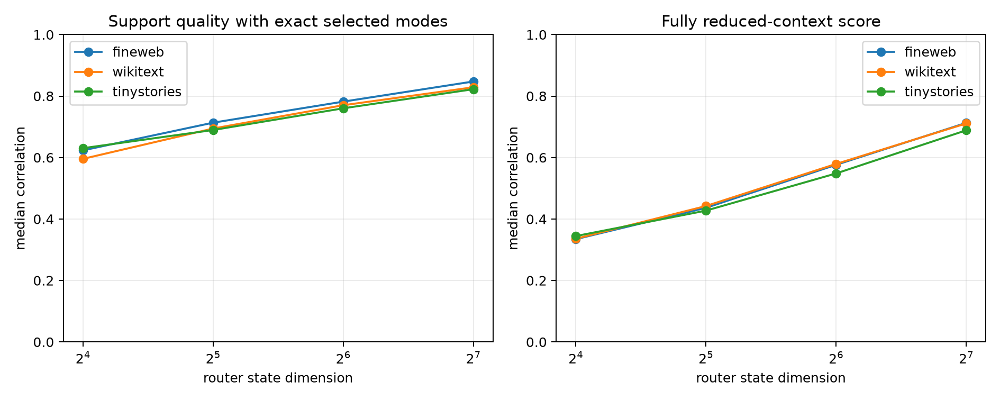

# Reduced-context quadratic router for layer-8 modes

For each exact 512D query eigenmode, the router estimates its realized magnitude from only the first `p` state-SVD coordinates using the same squared projection implied by the bilinear form. It selects 16 modes from those estimates. `exact routed` then evaluates the selected modes with the full 512D state and isolates support quality; `approximate routed` uses only reduced-context contributions and is the executable approximation.

## Locked hypotheses

- **P1_quadratic64_is_predictive: not supported.**
- **P2_quadratic64_beats_cluster64: not supported.**
- **P3_quadratic128_approaches_oracle: not supported.**
- **P4_quadratic64_recovers_support: supported.**
- **P5_quadratic64_is_executable: not supported.**
- **P6_router_improves_monotonically: supported.**

| Corpus | Router dim | Exact routed corr./R² | Approx. corr./R² | Oracle corr. | Support recall | Abs. mass | Prior cluster-64 corr. |
|---|---:|---:|---:|---:|---:|---:|---:|
| fineweb | 16 | 0.623/0.386 | 0.334/0.100 | 0.931 | 0.250 | 0.157 | 0.727 |
| fineweb | 32 | 0.713/0.501 | 0.436/0.181 | 0.931 | 0.312 | 0.180 | 0.727 |
| fineweb | 64 | 0.782/0.604 | 0.576/0.316 | 0.931 | 0.438 | 0.208 | 0.727 |
| fineweb | 128 | 0.847/0.711 | 0.713/0.488 | 0.931 | 0.500 | 0.240 | 0.727 |
| wikitext | 16 | 0.596/0.341 | 0.336/0.101 | 0.927 | 0.250 | 0.151 | 0.686 |
| wikitext | 32 | 0.694/0.480 | 0.442/0.187 | 0.927 | 0.312 | 0.175 | 0.686 |
| wikitext | 64 | 0.770/0.588 | 0.579/0.316 | 0.927 | 0.438 | 0.201 | 0.686 |
| wikitext | 128 | 0.829/0.671 | 0.711/0.482 | 0.927 | 0.500 | 0.232 | 0.686 |
| tinystories | 16 | 0.630/0.391 | 0.344/0.115 | 0.925 | 0.250 | 0.154 | 0.697 |
| tinystories | 32 | 0.690/0.468 | 0.427/0.173 | 0.925 | 0.312 | 0.179 | 0.697 |
| tinystories | 64 | 0.760/0.570 | 0.548/0.291 | 0.925 | 0.438 | 0.206 | 0.697 |
| tinystories | 128 | 0.822/0.672 | 0.689/0.458 | 0.925 | 0.500 | 0.237 | 0.697 |

This router is architecture-matched but still scans all 512 candidate modes to select 16. Success would establish that mode identity is predictable from a small state quotient; an additional candidate-index or hierarchical factorization would be required for a true sparse speedup.
