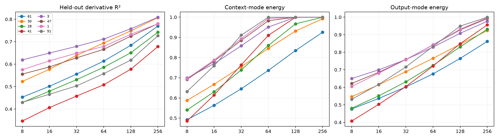

# Restricted tensor programs for Layer-8 sensitivity addresses

For each frequently routed prototype, the exact bilinear weights are contracted with its four input directions, producing a tensor `output × edit × full context`. FineWeb route-conditioned covariance defines a natural context metric. A Tucker program jointly truncates context and output modes and predicts held-out native derivatives without fitting the target writes.

## Locked hypotheses

- **B1_restricted_tensor_identity_is_exact: supported.**
- **B2_context_rank64_is_sufficient: not supported.**
- **B3_output_rank64_is_sufficient: not supported.**
- **B4_tucker64_predicts_heldout_writes: not supported.**
- **B5_tucker128_is_high_fidelity: not supported.**
- **B6_program_is_smaller_than_native_context: not supported.**

Active prototypes: `[61, 30, 28, 41, 3, 47, 1, 51]`. Maximum exact-identity relative error: **3.64e-06**.

| Prototype | Train/test sites | K90 | R²@64 / @128 | Context energy@64 | Output energy@64 |
|---:|---:|---:|---:|---:|---:|
| 61 | 964/975 | None | 0.614/0.684 | 0.736 | 0.676 |
| 30 | 306/280 | None | 0.694/0.748 | 0.845 | 0.765 |
| 28 | 187/205 | None | 0.586/0.651 | 0.860 | 0.725 |
| 41 | 118/105 | None | 0.508/0.577 | 0.910 | 0.721 |
| 3 | 100/101 | None | 0.712/0.758 | 0.951 | 0.829 |
| 47 | 76/85 | None | 0.666/0.725 | 0.983 | 0.841 |
| 1 | 68/68 | None | 0.679/0.733 | 0.993 | 0.843 |
| 51 | 50/70 | None | 0.557/0.618 | 1.000 | 0.833 |

The input prototype alone is an address. The restricted tensor plus current context is the exact conditional operation; Tucker rank measures whether that operation has a shorter reusable description.
