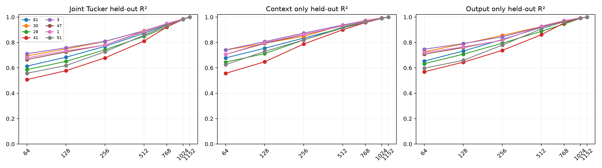

# Rank and metric red-team for Layer-8 restricted tensor programs

The initial equal-rank Tucker failure is extended to full rank, split into context-only and output-only approximations, compared under route-conditioned and global FineWeb covariance metrics, and repeated across three explicit ridge priors.

## Locked hypotheses

- **R1_full_rank_reconstructs: supported.**
- **R2_both_sides_limit_rank128: supported.**
- **R3_rank512_is_usually_sufficient: not supported.**
- **R4_route_metric_beats_global: not supported.**
- **R5_ridge_choice_is_not_decisive: supported.**
- **R6_no_small_equal_rank_program: supported.**
- **R7_rank90_program_is_parameter_compressive: supported.**

| Prototype | Route K90 | Joint R² @128 / 512 / full | Context/output R² @128 | Global joint @128 |
|---:|---:|---:|---:|---:|
| 61 | 768 | 0.684 / 0.873 / 1.0000 | 0.754 / 0.732 | 0.688 |
| 30 | 768 | 0.748 / 0.893 / 1.0000 | 0.793 / 0.789 | 0.764 |
| 28 | 768 | 0.651 / 0.848 / 1.0000 | 0.712 / 0.707 | 0.676 |
| 41 | 768 | 0.577 / 0.811 / 1.0000 | 0.647 / 0.644 | 0.628 |
| 3 | 768 | 0.758 / 0.891 / 1.0000 | 0.806 / 0.791 | 0.778 |
| 47 | 768 | 0.725 / 0.885 / 1.0000 | 0.792 / 0.759 | 0.748 |
| 1 | 768 | 0.733 / 0.890 / 1.0000 | 0.799 / 0.765 | 0.750 |
| 51 | 768 | 0.618 / 0.857 / 1.0000 | 0.729 / 0.659 | 0.680 |

Rank-128 ridge-sensitivity medians: `1e-06` → **0.699**, `0.0001` → **0.704**, `0.01` → **0.707**.

A full-rank reconstruction is a numerical identity check, not compression. Context-only and output-only curves distinguish whether failure comes from reading the current state, writing the derivative, or needing their joint product.
