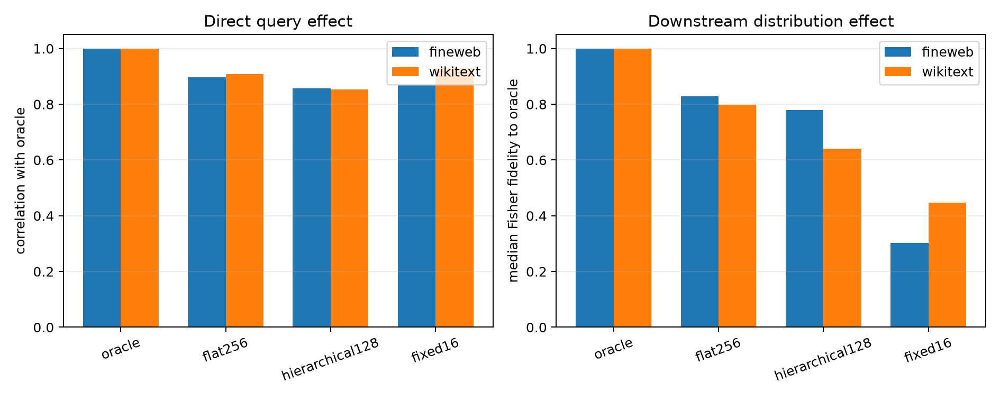

# Finite causal validation of the layer-8 mode router

For each of 16 natural write queries, six held-out final-position states with the largest absolute full-form score were selected. Each route chose 16 input eigenmodes. The selected 16D component was removed and rescaled to the same 5% input-state norm, the layer-8 MLP was recomputed, and all layers 9–17 plus the unembedding were rerun. The target is the per-example full-information oracle route, not the unedited model.

The hierarchical shortlist-128 setting was selected after the observational sweep; the causal thresholds were locked before this run. Consequently this is prospective for causal behavior but not a pristine prospective selection of the architecture.
The independently executed native block path and split layer-8 path agree to maximum absolute logit error `0.000e+00`.

## Locked causal hypotheses

- **C1_hierarchical_direct_effect: supported.**
- **C2_hierarchical_downstream_fidelity: supported.**
- **C3_hierarchical_near_flat: not supported.**
- **C4_hierarchical_beats_fixed: not supported.**
- **C5_causal_ood_stability: not supported.**

| Corpus | Route | Direct effect corr. | Median per-query corr. | Fisher fidelity/cosine | Oracle support recall | Native KL | KL/oracle |
|---|---|---:|---:|---:|---:|---:|---:|
| fineweb | oracle | 1.000 | 1.000 | 1.000/1.000 | 1.000 | 8.657e-04 | 1.000 |
| fineweb | flat256 | 0.897 | 0.885 | 0.828/0.924 | 0.750 | 4.719e-04 | 0.906 |
| fineweb | hierarchical128 | 0.858 | 0.770 | 0.779/0.898 | 0.688 | 3.558e-04 | 0.895 |
| fineweb | fixed16 | 0.868 | 0.778 | 0.302/0.774 | 0.312 | 1.190e-03 | 1.381 |
| wikitext | oracle | 1.000 | 1.000 | 1.000/1.000 | 1.000 | 1.353e-03 | 1.000 |
| wikitext | flat256 | 0.909 | 0.833 | 0.798/0.918 | 0.688 | 1.075e-03 | 0.937 |
| wikitext | hierarchical128 | 0.853 | 0.826 | 0.640/0.818 | 0.625 | 8.174e-04 | 0.877 |
| wikitext | fixed16 | 0.930 | 0.860 | 0.448/0.749 | 0.312 | 1.766e-03 | 1.280 |

Fisher fidelity is 1 for an exact match to the oracle logit effect, 0 when the squared softmax-local error equals the oracle effect energy, and can be negative. It measures agreement with this particular oracle intervention, not whether a route is independently useful or semantically meaningful.

## Red-team notes

The median hides substantial site and query heterogeneity. Hierarchical fidelity has a 10th–90th percentile range of 0.102–0.967 on FineWeb and 0.119–0.957 on WikiText. Support recall and causal fidelity are positively but imperfectly related: their correlations are 0.388 and 0.444. Mode identity alone therefore does not determine downstream equivalence.

Every edit was norm-matched, which prevents a trivial intervention-size advantage but means this is a directional-subspace test rather than literal removal of each route's naturally sized component. Sites were selected for large query scores, so the result applies to high-use sites and should not be read as an average-token estimate. The oracle is also query-local: it chooses modes by immediate layer-8 contribution, not by final-logit importance. A downstream-aware oracle could differ.
