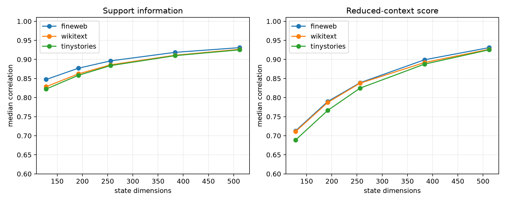

# Large-dimension sweep for the layer-8 quadratic router

The strongest frozen router estimates each mode's contribution from a prefix of the 512D state basis, chooses 16 modes, and then either evaluates those modes exactly (`exact routed`) or uses the reduced-context contributions (`approximate`). Dimension 512 equals oracle selection by construction and is included as the endpoint, not an independent success.

## Locked hypotheses

- **D1_dimension256_is_predictive: supported.**
- **D2_dimension256_is_near_oracle: supported.**
- **D3_at_least_192_dimensions_are_needed: supported.**
- **D4_dimension384_closes_oracle_gap: supported.**
- **D5_dimension256_reduced_score_is_predictive: supported.**

First dimension predictive on every corpus: **192**. First within 0.05 of oracle: **256**.

| Corpus | Router dim | Exact corr./R² | Approx. corr./R² | Oracle corr. | Support recall | Abs. mass |
|---|---:|---:|---:|---:|---:|---:|
| fineweb | 128 | 0.847/0.711 | 0.713/0.488 | 0.931 | 0.500 | 0.240 |
| fineweb | 192 | 0.877/0.762 | 0.790/0.606 | 0.931 | 0.562 | 0.259 |
| fineweb | 256 | 0.896/0.795 | 0.839/0.688 | 0.931 | 0.625 | 0.273 |
| fineweb | 384 | 0.919/0.838 | 0.899/0.798 | 0.931 | 0.750 | 0.294 |
| fineweb | 512 | 0.931/0.862 | 0.931/0.862 | 0.931 | 1.000 | 0.310 |
| wikitext | 128 | 0.829/0.671 | 0.711/0.482 | 0.927 | 0.500 | 0.232 |
| wikitext | 192 | 0.862/0.734 | 0.787/0.598 | 0.927 | 0.562 | 0.251 |
| wikitext | 256 | 0.886/0.776 | 0.838/0.676 | 0.927 | 0.625 | 0.266 |
| wikitext | 384 | 0.911/0.821 | 0.892/0.777 | 0.927 | 0.750 | 0.288 |
| wikitext | 512 | 0.927/0.843 | 0.927/0.843 | 0.927 | 1.000 | 0.304 |
| tinystories | 128 | 0.822/0.672 | 0.689/0.458 | 0.925 | 0.500 | 0.237 |
| tinystories | 192 | 0.858/0.731 | 0.766/0.571 | 0.925 | 0.562 | 0.256 |
| tinystories | 256 | 0.884/0.776 | 0.825/0.659 | 0.925 | 0.625 | 0.271 |
| tinystories | 384 | 0.910/0.821 | 0.888/0.779 | 0.925 | 0.750 | 0.292 |
| tinystories | 512 | 0.925/0.849 | 0.925/0.849 | 0.925 | 1.000 | 0.308 |

The endpoint shows the interpolation to oracle; the scientifically relevant quantity is how many state dimensions are needed before held-out and OOD gates pass. Exact routed scores isolate support information, while approximate scores additionally require contribution magnitudes to be represented in the reduced state.
