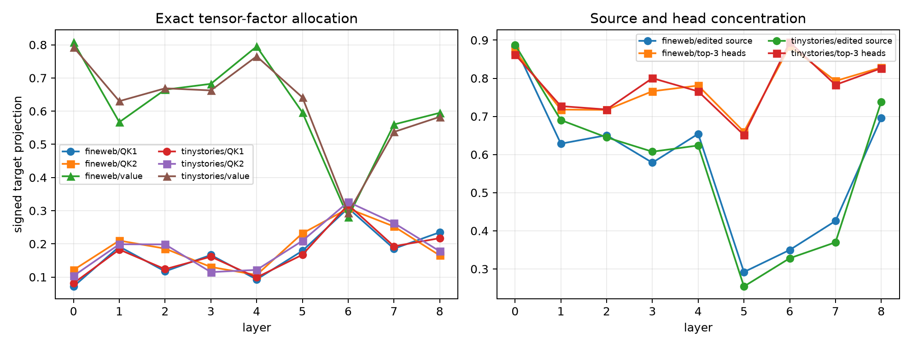

# Exact tensor-attention atlas for semantic broadcasting

For every changed attention edge in layers 0–8, the exact squared-bilinear contribution `(QK1)(QK2)V` is compared between base and counterfactual contexts. A three-factor Shapley identity assigns the changed write to QK1 routing, QK2 routing, and value/OV changes. Edge writes are projected onto the actual changed attention output; their signed projections recompose it exactly.

## Locked hypotheses

- **K1_edge_decomposition_is_exact: supported.**
- **K2_direct_source_edges_are_nontrivial: supported.**
- **K3_value_changes_drive_an_early_layer: supported.**
- **K4_both_qk_forms_are_used: supported.**
- **K5_a_recurrent_head_dominates_some_layer: supported.**
- **K6_three_heads_can_explain_half_a_layer: supported.**

| Corpus | Layer | QK1 / QK2 / value projection | Before/edit/after source projection | Top-3 head share | Most common top head (freq.) | Residual energy source/intermediate/final |
|---|---:|---:|---:|---:|---:|---:|
| fineweb | 0 | 0.072 / 0.121 / 0.808 | 0.117 / 0.883 / 0.000 | 0.871 | 3 (0.737) | 0.762 / 0.238 / 0.000 |
| fineweb | 1 | 0.192 / 0.210 / 0.567 | 0.231 / 0.628 / 0.086 | 0.718 | 5 (0.316) | 0.766 / 0.228 / 0.001 |
| fineweb | 2 | 0.117 / 0.186 / 0.665 | 0.179 / 0.651 / 0.125 | 0.717 | 3 (0.263) | 0.701 / 0.297 / 0.001 |
| fineweb | 3 | 0.167 / 0.130 / 0.682 | 0.156 / 0.579 / 0.155 | 0.766 | 4 (0.421) | 0.641 / 0.347 / 0.001 |
| fineweb | 4 | 0.093 / 0.106 / 0.795 | 0.095 / 0.654 / 0.191 | 0.781 | 7 (0.579) | 0.479 / 0.518 / 0.001 |
| fineweb | 5 | 0.179 / 0.232 / 0.596 | 0.260 / 0.292 / 0.442 | 0.660 | 7 (0.526) | 0.419 / 0.579 / 0.003 |
| fineweb | 6 | 0.308 / 0.306 / 0.281 | 0.430 / 0.350 / 0.160 | 0.884 | 1 (0.684) | 0.432 / 0.564 / 0.003 |
| fineweb | 7 | 0.186 / 0.253 / 0.560 | 0.280 / 0.426 / 0.270 | 0.793 | 8 (0.605) | 0.461 / 0.533 / 0.003 |
| fineweb | 8 | 0.235 / 0.165 / 0.595 | 0.158 / 0.696 / 0.095 | 0.828 | 1 (0.763) | 0.469 / 0.524 / 0.003 |
| tinystories | 0 | 0.081 / 0.104 / 0.793 | 0.112 / 0.888 / 0.000 | 0.863 | 3 (0.632) | 0.755 / 0.245 / 0.001 |
| tinystories | 1 | 0.183 / 0.199 / 0.630 | 0.187 / 0.690 / 0.120 | 0.727 | 1 (0.316) | 0.778 / 0.220 / 0.001 |
| tinystories | 2 | 0.124 / 0.198 / 0.669 | 0.153 / 0.645 / 0.130 | 0.718 | 3 (0.368) | 0.729 / 0.270 / 0.001 |
| tinystories | 3 | 0.161 / 0.115 / 0.662 | 0.148 / 0.607 / 0.153 | 0.800 | 4 (0.342) | 0.615 / 0.385 / 0.001 |
| tinystories | 4 | 0.099 / 0.122 / 0.765 | 0.118 / 0.624 / 0.237 | 0.766 | 7 (0.526) | 0.457 / 0.542 / 0.001 |
| tinystories | 5 | 0.167 / 0.209 / 0.641 | 0.277 / 0.254 / 0.402 | 0.651 | 7 (0.342) | 0.363 / 0.634 / 0.003 |
| tinystories | 6 | 0.318 / 0.326 / 0.293 | 0.451 / 0.328 / 0.175 | 0.894 | 1 (0.711) | 0.383 / 0.615 / 0.002 |
| tinystories | 7 | 0.193 / 0.263 / 0.537 | 0.295 / 0.370 / 0.289 | 0.783 | 8 (0.500) | 0.401 / 0.594 / 0.003 |
| tinystories | 8 | 0.217 / 0.178 / 0.583 | 0.137 / 0.738 / 0.112 | 0.826 | 1 (0.868) | 0.420 / 0.578 / 0.002 |

Maximum algebraic edge/Shapley recomposition error: `6.99e-14`. Maximum discrepancy to the native float32 contraction from accumulation order: `1.11e-05`.

Projection is local to each layer's changed attention write. It identifies how an attention delta is constructed, not how much that layer causes the final language-model output; finite downstream edge patching is the next gate.
