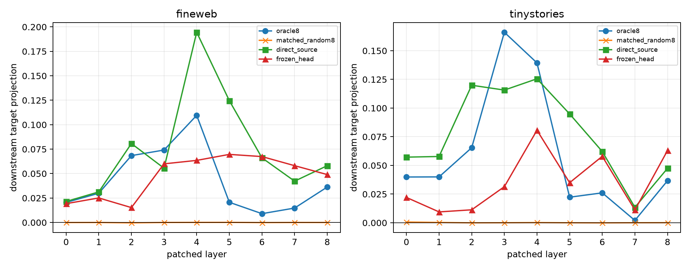

# Finite causal validation of semantic attention edges

The exact `(QK1)(QK2)V` terms ranked by the local attention atlas are now replaced across counterfactual worlds, the target layer's bilinear MLP is recomputed, and every later block is run normally. `oracle8` uses the eight locally strongest signed-projection edges. Each `matched_random8` edge preserves its oracle head and destination but resamples a different causal source. `direct_source` replaces every edge leaving the edited position; `frozen_head` replaces every affected edge in the head selected only from the FineWeb atlas.

## Locked hypotheses

- **L1_sparse_oracle_edges_are_downstream_causal: supported.**
- **L2_sparse_edges_beat_random_controls: supported.**
- **L3_frozen_recurrent_heads_are_downstream_causal: not supported.**
- **L4_direct_source_edges_are_a_major_downstream_route: not supported.**
- **L5_local_edge_score_predicts_downstream_effect: not supported.**
- **L6_insertion_and_removal_agree: not supported.**

| Corpus | Layer | Oracle-8 insertion/removal | Matched random insertion/removal | Direct-source insertion/removal | Frozen-head insertion/removal |
|---|---:|---:|---:|---:|---:|
| fineweb | 0 | 0.004 / 0.021 | -0.000 / -0.000 | 0.024 / 0.021 | 0.006 / 0.019 |
| fineweb | 1 | 0.020 / 0.030 | 0.000 / -0.000 | 0.018 / 0.031 | 0.007 / 0.025 |
| fineweb | 2 | 0.039 / 0.068 | 0.000 / -0.000 | 0.062 / 0.081 | 0.005 / 0.015 |
| fineweb | 3 | 0.050 / 0.074 | -0.000 / 0.000 | 0.048 / 0.056 | 0.038 / 0.060 |
| fineweb | 4 | 0.073 / 0.110 | 0.000 / 0.000 | 0.084 / 0.195 | 0.050 / 0.064 |
| fineweb | 5 | 0.009 / 0.021 | -0.000 / 0.000 | 0.108 / 0.125 | 0.037 / 0.070 |
| fineweb | 6 | 0.010 / 0.009 | -0.000 / -0.000 | 0.055 / 0.066 | 0.062 / 0.067 |
| fineweb | 7 | 0.006 / 0.015 | 0.000 / 0.000 | 0.033 / 0.042 | 0.029 / 0.058 |
| fineweb | 8 | 0.016 / 0.036 | 0.000 / -0.000 | 0.039 / 0.058 | 0.037 / 0.049 |
| tinystories | 0 | 0.011 / 0.040 | -0.000 / 0.001 | 0.043 / 0.057 | 0.009 / 0.022 |
| tinystories | 1 | 0.030 / 0.040 | 0.000 / 0.000 | 0.035 / 0.058 | 0.011 / 0.009 |
| tinystories | 2 | 0.036 / 0.065 | -0.000 / -0.000 | 0.106 / 0.120 | 0.008 / 0.011 |
| tinystories | 3 | 0.057 / 0.166 | 0.000 / 0.000 | 0.088 / 0.116 | 0.023 / 0.031 |
| tinystories | 4 | 0.081 / 0.139 | 0.000 / 0.000 | 0.098 / 0.126 | 0.036 / 0.081 |
| tinystories | 5 | 0.015 / 0.022 | -0.000 / -0.000 | 0.070 / 0.095 | 0.021 / 0.035 |
| tinystories | 6 | 0.008 / 0.026 | -0.000 / -0.000 | 0.056 / 0.062 | 0.055 / 0.058 |
| tinystories | 7 | 0.007 / 0.002 | 0.000 / 0.000 | 0.025 / 0.013 | 0.013 / 0.011 |
| tinystories | 8 | 0.021 / 0.037 | 0.000 / 0.000 | 0.051 / 0.047 | 0.057 / 0.063 |

| Corpus | Local→removal correlation | Local→insertion correlation | Insertion→removal correlation |
|---|---:|---:|---:|
| fineweb | 0.180 | 0.120 | 0.848 |
| tinystories | 0.357 | 0.221 | 0.622 |

FineWeb selected layer: **4**. Oracle/random absolute-projection ratios: fineweb=984.15, tinystories=505.57.
Maximum atlas/direct local projection discrepancy: `1.21e-07`. Maximum base-logit discrepancy across split points: `2.91e-05`.

An edge patch is a cross-world causal replacement, not a claim that the edge independently stores the edited word's meaning. Large source or whole-head patches test routes with very different budgets; only oracle-eight versus matched-random-eight is budget matched.
