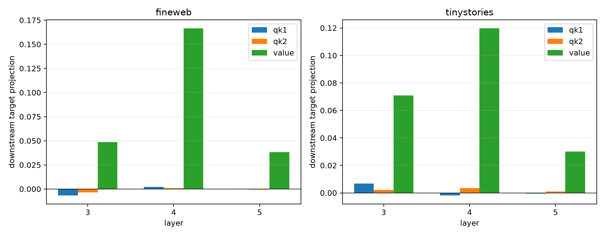

# Causal QK1/QK2/value factorization of semantic attention routes

For the frozen-64 and per-example oracle-64 edge routes, all eight QK1/QK2/value hybrid worlds are constructed exactly. Each world replaces only the selected edge terms, recomputes the target bilinear MLP, and runs the complete suffix. Vector-valued Shapley effects are computed separately for insertion into the base context and removal from the counterfactual context.

## Locked hypotheses

- **T1_factor_shapley_recomposes_routes: supported.**
- **T2_value_content_dominates_layer4: supported.**
- **T3_qk_routing_is_nontrivial: not supported.**
- **T4_local_factor_mix_predicts_downstream_mix: supported.**
- **T5_factor_mix_transfers_ood: supported.**
- **T6_factor_attribution_is_cross_world_stable: supported.**
- **T7_frozen_and_oracle_use_similar_factors: supported.**

| Corpus | Layer | Route | Removal route projection | QK1 / QK2 / value Shapley projection | Absolute shares |
|---|---:|---|---:|---:|---:|
| fineweb | 3 | frozen64 | 0.042 | -0.007 / -0.004 / 0.049 | 0.150 / 0.073 / 0.670 |
| fineweb | 3 | oracle64 | 0.075 | 0.008 / 0.006 / 0.039 | 0.197 / 0.103 / 0.644 |
| fineweb | 4 | frozen64 | 0.183 | 0.002 / 0.001 / 0.167 | 0.074 / 0.046 / 0.869 |
| fineweb | 4 | oracle64 | 0.294 | -0.005 / -0.003 / 0.223 | 0.059 / 0.108 / 0.817 |
| fineweb | 5 | frozen64 | 0.032 | 0.000 / -0.001 / 0.038 | 0.034 / 0.145 / 0.717 |
| fineweb | 5 | oracle64 | 0.101 | 0.001 / 0.009 / 0.079 | 0.058 / 0.096 / 0.837 |
| tinystories | 3 | frozen64 | 0.097 | 0.007 / 0.002 / 0.071 | 0.061 / 0.041 / 0.822 |
| tinystories | 3 | oracle64 | 0.216 | 0.009 / 0.004 / 0.095 | 0.080 / 0.106 / 0.780 |
| tinystories | 4 | frozen64 | 0.108 | -0.002 / 0.003 / 0.120 | 0.050 / 0.076 / 0.874 |
| tinystories | 4 | oracle64 | 0.241 | 0.008 / 0.012 / 0.156 | 0.074 / 0.117 / 0.809 |
| tinystories | 5 | frozen64 | 0.035 | -0.000 / 0.001 / 0.030 | 0.071 / 0.131 / 0.841 |
| tinystories | 5 | oracle64 | 0.143 | 0.001 / 0.002 / 0.127 | 0.045 / 0.060 / 0.891 |

| Corpus | Local→removal factor correlation | Local→insertion | Insertion→removal | Frozen/oracle cosine at L4 |
|---|---:|---:|---:|---:|
| fineweb | 0.565 | 0.443 | 0.884 | 0.999 |
| tinystories | 0.726 | 0.678 | 0.739 | 0.997 |

Maximum vector Shapley recomposition error: `6.80e-08`. Layer-4 absolute-share L1 distance across corpora: `0.060`.

These Shapley values allocate the effect of a declared cross-world edge replacement. They are exact for that intervention game, but they are not unique percentages of where information is stored: changing the background world or the coalition definition changes the causal question.
