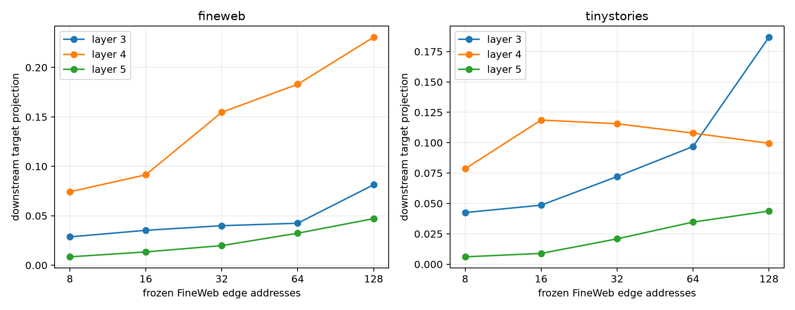

# Frozen semantic-attention route transfer

Fixed edge addresses are learned only from the unused second FineWeb context for each lexical pair. Edges are ranked by mean absolute local projection, frozen, and evaluated on the first FineWeb contexts and on TinyStories. `oracle64` is selected separately per evaluation example and is only a ceiling. Eight controls preserve every frozen edge's source and destination while cyclically shifting its head.

## Locked hypotheses

- **S1_frozen_route_is_causal: supported.**
- **S2_frozen_route_recovers_half_oracle: not supported.**
- **S3_frozen_heads_beat_shifted_controls: not supported.**
- **S4_larger_frozen_route_adds_effect: not supported.**
- **S5_frozen_route_transfers_ood: supported.**
- **S6_frozen_route_is_cross_world_stable: not supported.**

FineWeb-selected layer: **4**.

| Corpus | Layer | Frozen 8/16/32/64/128 removal | Signed-64 | Oracle-64 | Head-shift median |
|---|---:|---:|---:|---:|---:|
| fineweb | 3 | 0.029/0.035/0.040/0.042/0.081 | 0.041 | 0.075 | -0.007 |
| fineweb | 4 | 0.074/0.091/0.155/0.183/0.231 | 0.184 | 0.294 | 0.084 |
| fineweb | 5 | 0.008/0.013/0.020/0.032/0.047 | 0.042 | 0.101 | 0.011 |
| tinystories | 3 | 0.043/0.049/0.072/0.097/0.187 | 0.081 | 0.216 | 0.031 |
| tinystories | 4 | 0.079/0.119/0.116/0.108/0.100 | 0.106 | 0.241 | 0.082 |
| tinystories | 5 | 0.006/0.009/0.021/0.035/0.044 | 0.034 | 0.143 | 0.016 |

| Corpus | Frozen/oracle at selected layer | Frozen/head-shift | Insertion→removal correlation |
|---|---:|---:|---:|
| fineweb | 0.623 | 2.167 | 0.863 |
| tinystories | 0.448 | 1.320 | 0.616 |

TinyStories retention relative to FineWeb at the selected layer: `0.589`.

This tests recurrence of edge addresses, not recurrence of a semantic activation direction. A fixed route can broadcast many lexical changes without representing their shared human category.
