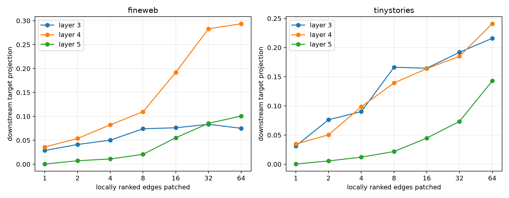

# Rank-resolved red-team of semantic attention edges

The earlier random-source control was too easy because most locally selected edges leave the edited token. This red-team ranks every exact edge by local signed projection, patches nested top-k sets and disjoint rank bands, and separately ranks edges from the edited source and from all other sources. Every patch recomputes the layer MLP and the complete suffix.

## Locked hypotheses

- **R1_top8_beats_next8: supported.**
- **R2_more_local_edges_add_downstream_effect: supported.**
- **R3_local_rank_bands_predict_downstream_bands: not supported.**
- **R4_edited_source_explains_top8: not supported.**
- **R5_propagated_sources_are_causal: not supported.**
- **R6_top64_is_a_major_route: not supported.**
- **R7_larger_route_stabilizes_cross_world_patch: not supported.**

| Corpus | Layer | Top-1/2/4/8/16/32/64 removal projection | Edit-source top8 | Non-edit top8 |
|---|---:|---:|---:|---:|
| fineweb | 3 | 0.029/0.041/0.050/0.074/0.076/0.084/0.075 | 0.027 | 0.020 |
| fineweb | 4 | 0.036/0.054/0.082/0.110/0.192/0.283/0.294 | 0.089 | 0.034 |
| fineweb | 5 | 0.000/0.007/0.011/0.021/0.055/0.085/0.101 | 0.019 | 0.015 |
| tinystories | 3 | 0.031/0.076/0.090/0.166/0.165/0.192/0.216 | 0.095 | 0.029 |
| tinystories | 4 | 0.034/0.050/0.099/0.139/0.164/0.185/0.241 | 0.105 | 0.021 |
| tinystories | 5 | 0.000/0.006/0.012/0.022/0.045/0.073/0.143 | 0.032 | 0.018 |

| Corpus | Local-band→downstream correlation | Top64 insertion→removal correlation | Top8/next8 at L4 | Edit-source/global top8 at L4 |
|---|---:|---:|---:|---:|
| fineweb | 0.388 | 0.890 | 3.874 | 0.815 |
| tinystories | 0.647 | 0.558 | 6.612 | 0.757 |

Rank is defined only by the local attention-write projection. The downstream test is independent of that local ordering but uses the same examples; it evaluates route discovery, not semantic abstraction or context-independent recurrence.
