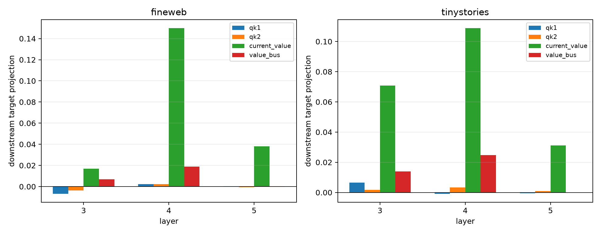

# Current-value versus inherited-bus causality in semantic attention routes

The earlier value factor is split into the target layer's current value projection and the value bus inherited from layer 0. Together with QK1 and QK2 this gives sixteen exact hybrid worlds. The selected edge write is `(QK1)(QK2)[(1−λ)V_current + λV_bus]`; complete layer MLP and suffix recomputation follows every hybrid.

## Locked hypotheses

- **U1_four_factor_shapley_recomposes_routes: supported.**
- **U2_both_value_paths_are_substantial: not supported.**
- **U3_value_paths_cancel: not supported.**
- **U4_value_path_mix_transfers_ood: supported.**
- **U5_value_path_attribution_is_cross_world_stable: supported.**
- **U6_frozen_and_oracle_value_paths_match: supported.**
- **U7_qk_remains_secondary: supported.**

| Corpus | Layer | Route | λ | Removal route | QK1 / QK2 / current-V / bus-V projection | Absolute shares | V cancellation |
|---|---:|---|---:|---:|---:|---:|---:|
| fineweb | 3 | frozen64 | -4.000 | 0.042 | -0.007 / -0.004 / 0.017 / 0.007 | 0.134 / 0.072 / 0.438 / 0.113 | 1.000 |
| fineweb | 3 | oracle64 | -4.000 | 0.075 | 0.008 / 0.006 / 0.018 / 0.011 | 0.199 / 0.103 / 0.429 / 0.118 | 1.000 |
| fineweb | 4 | frozen64 | -4.188 | 0.183 | 0.002 / 0.002 / 0.150 / 0.019 | 0.068 / 0.051 / 0.690 / 0.151 | 1.000 |
| fineweb | 4 | oracle64 | -4.188 | 0.294 | -0.005 / -0.003 / 0.216 / 0.022 | 0.058 / 0.106 / 0.658 / 0.107 | 1.000 |
| fineweb | 5 | frozen64 | -0.056 | 0.032 | 0.000 / -0.001 / 0.038 / -0.000 | 0.033 / 0.145 / 0.699 / 0.013 | 0.980 |
| fineweb | 5 | oracle64 | -0.056 | 0.101 | 0.001 / 0.009 / 0.084 / -0.001 | 0.058 / 0.090 / 0.810 / 0.005 | 0.981 |
| tinystories | 3 | frozen64 | -4.000 | 0.097 | 0.007 / 0.002 / 0.071 / 0.014 | 0.062 / 0.043 / 0.634 / 0.129 | 1.000 |
| tinystories | 3 | oracle64 | -4.000 | 0.216 | 0.009 / 0.004 / 0.084 / 0.017 | 0.079 / 0.105 / 0.564 / 0.078 | 1.000 |
| tinystories | 4 | frozen64 | -4.188 | 0.108 | -0.001 / 0.003 / 0.109 / 0.025 | 0.048 / 0.069 / 0.656 / 0.200 | 1.000 |
| tinystories | 4 | oracle64 | -4.188 | 0.241 | 0.008 / 0.012 / 0.146 / 0.027 | 0.070 / 0.096 / 0.714 / 0.132 | 1.000 |
| tinystories | 5 | frozen64 | -0.056 | 0.035 | -0.001 / 0.001 / 0.031 / -0.000 | 0.070 / 0.127 / 0.822 / 0.016 | 0.973 |
| tinystories | 5 | oracle64 | -0.056 | 0.143 | 0.001 / 0.002 / 0.125 / -0.001 | 0.044 / 0.060 / 0.859 / 0.013 | 0.974 |

| Corpus | Local→downstream factor correlation | Insertion→removal | Frozen/oracle cosine at L4 |
|---|---:|---:|---:|
| fineweb | 0.554 | 0.901 | 0.999 |
| tinystories | 0.697 | 0.769 | 0.996 |

Maximum vector Shapley recomposition error: `8.64e-08`. Layer-4 four-factor share L1 distance across corpora: `0.121`.

A low cancellation ratio means the two value paths have opposing target projections under this intervention game. It does not imply either path can be deleted safely: their difference is the implemented operation.
