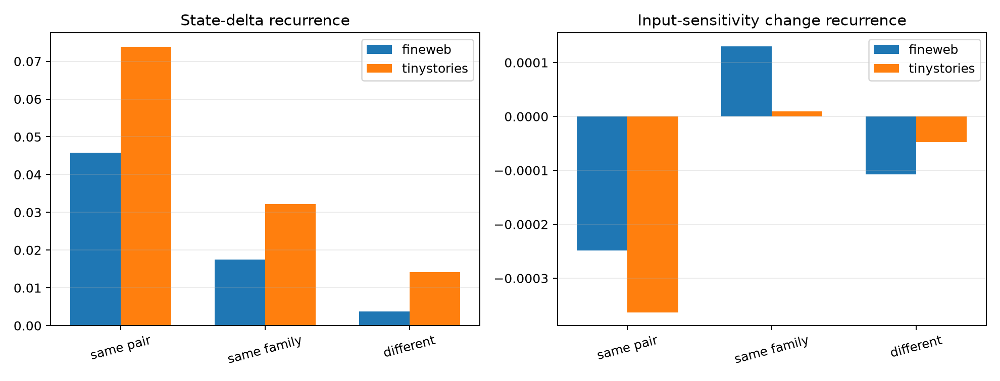

# Natural semantic counterfactuals at Layer 8

Natural FineWeb and TinyStories contexts are edited at one token 7–31 positions before the final prediction. Each semantic family contains three or four distinct lexical substitutions, allowing same-word recurrence to be separated from abstraction across words. The analysis compares Layer-8 state deltas, changes in the four leading input/logit/Fisher sensitivity projectors, and a finite patch of only the final-position Layer-8 MLP input.

## Locked hypotheses

- **F1_lexical_edit_directions_recur: not supported.**
- **F2_semantic_families_abstract_across_words: not supported.**
- **F3_semantic_families_recurrently_reconfigure_input_sensitivity: not supported.**
- **F4_semantic_families_recurrently_reconfigure_behavior: not supported.**
- **F5_semantic_deltas_hit_top_local_axes: not supported.**
- **F6_final_layer8_mlp_state_mediates_semantic_edit: not supported.**
- **F7_minimal_edits_change_behavior: supported.**
- **F8_local_input_operator_is_edit_stable: supported.**
- **F9_local_behavioral_operator_is_edit_stable: supported.**

| Corpus | Full KL | Prediction changed | Top-axis delta energy | L8 patch fidelity / KL ratio | Input/logit/Fisher axis preservation |
|---|---:|---:|---:|---:|---:|
| fineweb | 6.913e-04 | 0.000 | 0.012 | 0.122 / 0.036 | 0.995 / 0.996 / 0.997 |
| tinystories | 1.964e-03 | 0.018 | 0.011 | 0.137 / 0.032 | 0.989 / 0.992 / 0.994 |

| Corpus | Comparison | State delta | Input-projector Δ | Logit-projector Δ | Fisher-projector Δ | Probability delta |
|---|---|---:|---:|---:|---:|---:|
| fineweb | same_pair | 0.046 | -0.000 | 0.000 | -0.000 | 0.000 |
| fineweb | same_family_different_pair | 0.017 | 0.000 | -0.000 | 0.000 | 0.000 |
| fineweb | different_family | 0.004 | -0.000 | 0.000 | 0.000 | -0.000 |
| tinystories | same_pair | 0.074 | -0.000 | 0.000 | 0.000 | 0.000 |
| tinystories | same_family_different_pair | 0.032 | 0.000 | -0.000 | 0.000 | 0.000 |
| tinystories | different_family | 0.014 | -0.000 | 0.000 | 0.000 | 0.000 |

Same-pair recurrence can reflect lexical identity. Evidence for an abstract semantic mechanism requires same-family recurrence across different token pairs, above different-family controls, and preferably OOD replication. Final-position patching measures one mediation route; low fidelity does not imply the semantic edit is absent from earlier positions, attention, or the value bus.
