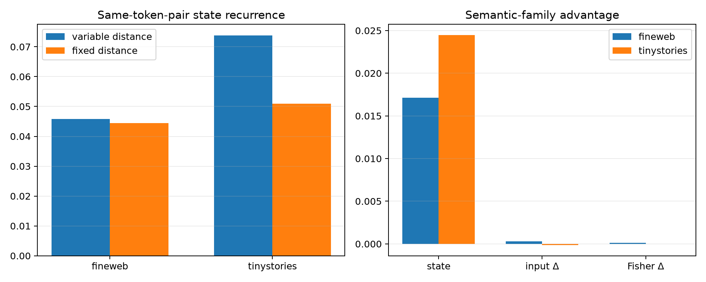

# Fixed-position semantic counterfactual red-team

This repeats the natural one-token counterfactual experiment on cropped 64-token windows. Every edited token is at position 47 and every effect is evaluated at position 63, exactly 16 tokens later. This removes edit distance, absolute position, and sequence length as explanations of the earlier non-recurrence.

## Locked hypotheses

- **G1_fixed_distance_lexical_directions_recur: not supported.**
- **G2_fixed_distance_semantic_abstraction: not supported.**
- **G3_fixed_distance_input_reconfiguration_recurs: not supported.**
- **G4_fixed_distance_behavior_reconfiguration_recurs: not supported.**
- **G5_fixed_distance_deltas_hit_top_axes: not supported.**
- **G6_fixed_distance_final_mlp_mediates: not supported.**
- **G7_position_control_rescues_lexical_recurrence: not supported.**
- **G8_high_effect_semantic_state_abstraction: not supported.**
- **G9_high_effect_input_reconfiguration_recurs: not supported.**
- **G10_high_effect_behavior_reconfiguration_recurs: not supported.**
- **G11_high_effect_deltas_hit_top_axes: not supported.**
- **G12_high_effect_final_mlp_mediates: not supported.**
- **G13_fixed_distance_input_operator_is_edit_stable: supported.**
- **G14_fixed_distance_behavioral_operator_is_edit_stable: supported.**

| Corpus | Full KL | Prediction changed | Top-axis delta energy | L8 patch fidelity / KL ratio | Input/logit/Fisher preservation | Same-pair state cosine (variable→fixed) |
|---|---:|---:|---:|---:|---:|---:|
| fineweb | 2.886e-03 | 0.035 | 0.009 | 0.107 / 0.030 | 0.985 / 0.985 / 0.988 | 0.046→0.044 |
| tinystories | 2.008e-03 | 0.070 | 0.010 | 0.134 / 0.022 | 0.991 / 0.992 / 0.995 | 0.074→0.051 |

## High-effect strength control

The two largest full-KL contexts per lexical pair were selected after the aggregate fixed-position result but before inspecting their internal recurrence metrics.

| Corpus | Full KL | Top-axis delta energy | Patch fidelity / KL ratio | Same-family state/input/Fisher advantage |
|---|---:|---:|---:|---:|
| fineweb | 6.440e-03 | 0.010 | 0.107 / 0.022 | 0.026 / 0.000 / 0.000 |
| tinystories | 4.124e-03 | 0.011 | 0.110 / 0.020 | 0.042 / 0.000 / 0.000 |

| Corpus | Comparison | State delta | Input-projector Δ | Logit-projector Δ | Fisher-projector Δ | Probability delta |
|---|---|---:|---:|---:|---:|---:|
| fineweb | same_pair | 0.044 | -0.001 | 0.001 | 0.000 | 0.000 |
| fineweb | same_family_different_pair | 0.023 | 0.000 | 0.000 | 0.000 | 0.000 |
| fineweb | different_family | 0.006 | 0.000 | 0.000 | 0.000 | 0.000 |
| tinystories | same_pair | 0.051 | -0.001 | 0.002 | 0.000 | 0.000 |
| tinystories | same_family_different_pair | 0.033 | -0.000 | 0.000 | 0.000 | -0.000 |
| tinystories | different_family | 0.008 | 0.000 | 0.000 | 0.000 | 0.000 |

If same-pair recurrence remains weak, position was not the main reason semantic edit directions rotated. If lexical recurrence improves without across-word family recurrence, the reusable object is token-pair-specific rather than abstractly semantic.
