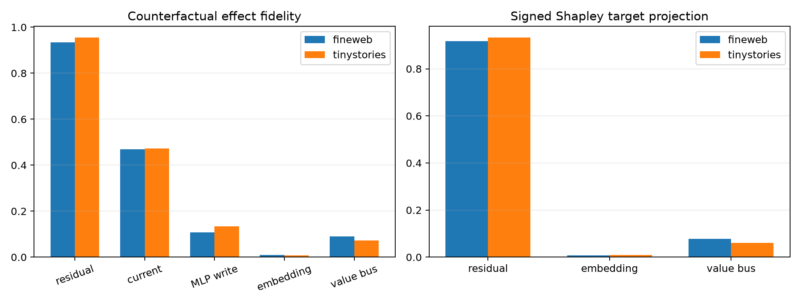

# Layer-8 boundary paths for semantic counterfactuals

The fixed-position natural counterfactual panel is recomposed through all eight combinations of three Layer-8 boundary carriers: the entire residual sequence, the stable embedding stream injected at later blocks, and the attention value bus. Current-position residual and final-MLP-write-only patches are additional controls. Signed Shapley values allocate projection onto the exact counterfactual logit effect and sum exactly even when paths interact.

## Locked hypotheses

- **H1_full_boundary_recomposition_is_exact: supported.**
- **H2_residual_sequence_is_major_carrier: supported.**
- **H3_current_position_is_not_sufficient: supported.**
- **H4_prior_positions_matter: supported.**
- **H5_nonresidual_carriers_matter: not supported.**
- **H6_shapley_recomposes_target: supported.**

| Corpus | Route | Fidelity / cosine | KL/full | Target projection |
|---|---|---:|---:|---:|
| fineweb | residual_only | 0.934 / 0.967 | 0.880 | 0.904 |
| fineweb | embedding_only | 0.009 / 0.269 | 0.000 | 0.005 |
| fineweb | bus_only | 0.090 / 0.442 | 0.024 | 0.053 |
| fineweb | residual_embedding | 0.935 / 0.968 | 0.889 | 0.907 |
| fineweb | residual_bus | 0.999 / 1.000 | 0.983 | 0.991 |
| fineweb | embedding_bus | 0.095 / 0.457 | 0.029 | 0.054 |
| fineweb | full_boundary | 1.000 / 1.000 | 1.000 | 1.000 |
| fineweb | current_position_only | 0.469 / 0.777 | 0.253 | 0.385 |
| fineweb | final_mlp_write_only | 0.107 / 0.440 | 0.029 | 0.071 |
| tinystories | residual_only | 0.956 / 0.982 | 0.884 | 0.926 |
| tinystories | embedding_only | 0.007 / 0.244 | 0.000 | 0.004 |
| tinystories | bus_only | 0.072 / 0.360 | 0.021 | 0.039 |
| tinystories | residual_embedding | 0.960 / 0.982 | 0.893 | 0.933 |
| tinystories | residual_bus | 0.999 / 1.000 | 0.983 | 0.991 |
| tinystories | embedding_bus | 0.080 / 0.389 | 0.022 | 0.046 |
| tinystories | full_boundary | 1.000 / 1.000 | 1.000 | 1.000 |
| tinystories | current_position_only | 0.472 / 0.792 | 0.204 | 0.330 |
| tinystories | final_mlp_write_only | 0.134 / 0.503 | 0.023 | 0.085 |

| Corpus | Residual Shapley | Embedding Shapley | Value-bus Shapley |
|---|---:|---:|---:|
| fineweb | 0.917 | 0.007 | 0.078 |
| tinystories | 0.934 | 0.009 | 0.060 |

Maximum per-edit Shapley sum error: `2.44e-07`.

These are boundary-carrier attributions, not percentages of information stored. A carrier can be necessary through interactions, and replacing a whole sequence is a larger intervention than replacing its final position.
