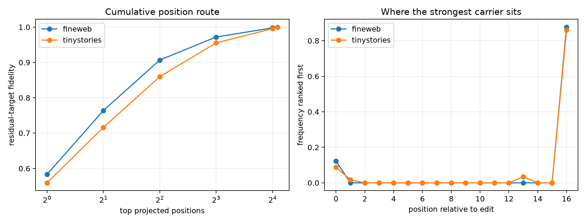

# Position localization of Layer-8 semantic residual carriers

The whole residual sequence carried nearly all of the fixed semantic-counterfactual effect. This experiment patches each of the seventeen causally affected Layer-8 positions individually, ranks them by signed Fisher projection onto the whole-residual target, evaluates exact cumulative subsets, and compares source, intermediate, and final position groups.

## Locked hypotheses

- **J1_causal_prefix_is_unchanged: supported.**
- **J2_final_position_alone_is_partial: supported.**
- **J3_intermediate_positions_carry_signal: supported.**
- **J4_top4_positions_form_a_compact_route: supported.**
- **J5_top8_positions_are_near_sufficient: supported.**
- **J6_position_effects_are_nearly_additive: supported.**

| Corpus | Positions | Fidelity / cosine | KL/full | Target projection |
|---|---:|---:|---:|---:|
| fineweb | top 1 | 0.583 / 0.829 | 0.358 | 0.478 |
| fineweb | top 2 | 0.764 / 0.910 | 0.556 | 0.679 |
| fineweb | top 4 | 0.907 / 0.961 | 0.737 | 0.835 |
| fineweb | top 8 | 0.972 / 0.988 | 0.944 | 0.962 |
| fineweb | top 16 | 0.998 / 0.999 | 1.027 | 1.009 |
| fineweb | top 17 | 1.000 / 1.000 | 1.000 | 1.000 |
| tinystories | top 1 | 0.559 / 0.834 | 0.263 | 0.392 |
| tinystories | top 2 | 0.716 / 0.906 | 0.459 | 0.600 |
| tinystories | top 4 | 0.860 / 0.949 | 0.702 | 0.781 |
| tinystories | top 8 | 0.955 / 0.981 | 0.937 | 0.947 |
| tinystories | top 16 | 0.995 / 0.998 | 1.026 | 1.011 |
| tinystories | top 17 | 1.000 / 1.000 | 1.000 | 1.000 |

| Corpus | Group | Fidelity / cosine | KL/full | Target projection |
|---|---|---:|---:|---:|
| fineweb | source_only | 0.152 / 0.582 | 0.049 | 0.093 |
| fineweb | intermediate_only | 0.531 / 0.840 | 0.206 | 0.348 |
| fineweb | final_only | 0.575 / 0.816 | 0.334 | 0.445 |
| fineweb | source_final | 0.761 / 0.910 | 0.451 | 0.634 |
| tinystories | source_only | 0.167 / 0.536 | 0.041 | 0.103 |
| tinystories | intermediate_only | 0.627 / 0.839 | 0.325 | 0.480 |
| tinystories | final_only | 0.526 / 0.808 | 0.239 | 0.382 |
| tinystories | source_final | 0.679 / 0.890 | 0.375 | 0.514 |

| Corpus | Linear sum fidelity/cosine | Most frequent individually top relative position |
|---|---:|---:|
| fineweb | 0.996 / 0.998 | +16 (0.877) |
| tinystories | 0.996 / 0.999 | +16 (0.860) |

Maximum relative residual difference before the edited token: `0.00e+00`.

Ranking uses the target effect and is therefore an oracle localization, not an executable router. A compact position subset would identify where to trace next, not establish a semantic feature basis inside those positions.
