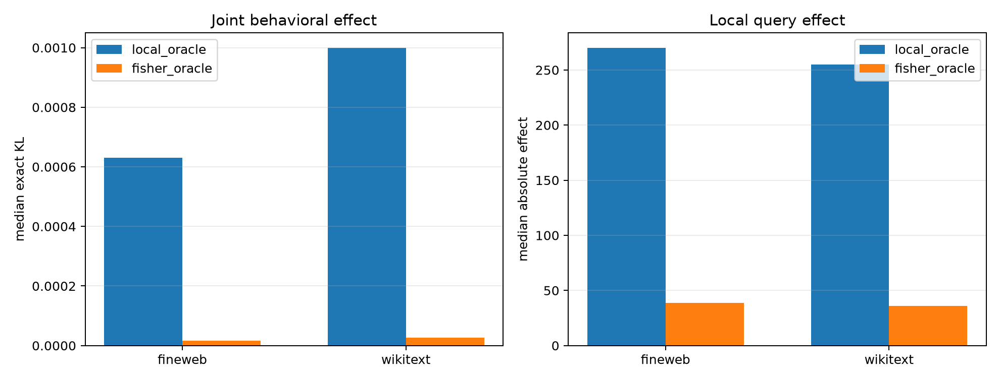

# Stratified downstream-Fisher oracle

This repairs the failed ordinary-Monte-Carlo pilot. Each suffix Fisher estimate sums exact probability-weighted score gradients for the top 16 output tokens, then estimates the remaining probability tail with 16 conditional samples. Two independent tail samples test stability. Selection uses the first estimate; the second and finite interventions are held-out checks.

## Locked post-pilot hypotheses

- **R1_stratified_sketch_is_stable: supported.**
- **R2_fisher_modes_pass_matched_finite_control: supported.**
- **R3_fisher_set_has_larger_combined_effect: not supported.**
- **R4_individual_importance_cancels_in_combination: supported.**
- **R5_local_and_fisher_supports_differ: supported.**
- **R6_hierarchy_targets_local_computation: supported.**

| Corpus | Sketch corr./top16 recall | Route | Native KL | |query effect| | Local/Fisher support | Fidelity to local/Fisher effect |
|---|---:|---|---:|---:|---:|---:|
| fineweb | 0.995/0.938 | local_oracle | 6.306e-04 | 2.701e+02 | 1.000/0.312 | 1.000/-24.774 |
| fineweb | 0.995/0.938 | fisher_oracle | 1.653e-05 | 3.874e+01 | 0.312/1.000 | 0.184/1.000 |
| fineweb | 0.995/0.938 | flat256 | 5.701e-04 | 2.408e+02 | 0.688/0.312 | 0.831/-23.336 |
| fineweb | 0.995/0.938 | hierarchical128 | 5.155e-04 | 2.124e+02 | 0.656/0.281 | 0.769/-20.061 |
| fineweb | 0.995/0.938 | fixed16 | 6.340e-04 | 2.456e+02 | 0.312/0.125 | 0.430/-33.352 |
| fineweb | top-token probability mass 0.914 | matched single modes | KL ratio **107.08×** | win **1.000** | — | — |
| wikitext | 0.996/0.938 | local_oracle | 9.994e-04 | 2.549e+02 | 1.000/0.312 | 1.000/-22.210 |
| wikitext | 0.996/0.938 | fisher_oracle | 2.694e-05 | 3.606e+01 | 0.312/1.000 | 0.227/1.000 |
| wikitext | 0.996/0.938 | flat256 | 9.029e-04 | 2.077e+02 | 0.688/0.312 | 0.842/-20.577 |
| wikitext | 0.996/0.938 | hierarchical128 | 8.205e-04 | 1.985e+02 | 0.688/0.312 | 0.801/-17.712 |
| wikitext | 0.996/0.938 | fixed16 | 1.253e-03 | 1.904e+02 | 0.281/0.125 | 0.207/-25.452 |
| wikitext | top-token probability mass 0.632 | matched single modes | KL ratio **168.53×** | win **1.000** | — | — |

Local and downstream importance are different objectives. In particular, a set of modes chosen for large individual Fisher effects need not have a large joint effect: their logit changes can cancel, and the matched-norm joint projection changes their natural component amplitudes. The single-mode and combined-route columns must therefore be read together.
