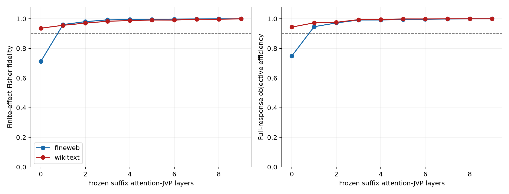

# Layer-8 suffix attention-subset localization

The native forward pass is fixed. Only selected attention derivatives in blocks 9–17 are allowed to carry a Layer-8 perturbation. All subsets of up to three blocks were searched on separate FineWeb discovery rows; the masks and wider cumulative order were then frozen before FineWeb and WikiText evaluation.

## Locked hypotheses

- **C0_endpoints_reproduce: supported.**
- **C1_compact_reusable_router: supported.**
- **C2_broad_suffix_required: not supported.**
- **C3_selection_transfers_ood: not supported.**
- **C4_attention_signal_is_detectable: supported.**
- **R1_robust_compact_router_redteam: not supported.**

Best size-3 discovery mask: `[9, 10, 11]`. Frozen order: `[9, 10, 11, 16, 12, 17, 13, 14, 15]`.

| Corpus | Layers | Full-reference fidelity (95% bootstrap interval) | Backprop-oracle fidelity | Objective efficiency | Support recall |
|---|---:|---:|---:|---:|---:|
| fineweb | 0 | 0.713 [-0.054, 0.915] | 0.702 | 0.749 | 0.188 |
| fineweb | 1 | 0.961 [0.783, 0.984] | 0.884 | 0.947 | 0.688 |
| fineweb | 2 | 0.981 [0.902, 0.986] | 0.955 | 0.972 | 0.750 |
| fineweb | 3 | 0.993 [0.979, 0.997] | 0.974 | 0.992 | 0.875 |
| fineweb | 4 | 0.995 [0.989, 0.998] | 0.970 | 0.992 | 0.875 |
| fineweb | 5 | 0.996 [0.986, 0.999] | 0.979 | 0.995 | 0.906 |
| fineweb | 6 | 0.998 [0.995, 0.999] | 0.988 | 0.996 | 0.906 |
| fineweb | 7 | 0.999 [0.998, 1.000] | 0.987 | 0.999 | 0.938 |
| fineweb | 8 | 1.000 [0.998, 1.000] | 0.989 | 1.000 | 1.000 |
| fineweb | 9 | 1.000 [1.000, 1.000] | 0.994 | 1.000 | 1.000 |
| wikitext | 0 | 0.936 [0.868, 0.964] | 0.932 | 0.944 | 0.594 |
| wikitext | 1 | 0.956 [0.913, 0.985] | 0.923 | 0.973 | 0.750 |
| wikitext | 2 | 0.971 [0.919, 0.985] | 0.964 | 0.976 | 0.750 |
| wikitext | 3 | 0.983 [0.965, 0.994] | 0.952 | 0.994 | 0.812 |
| wikitext | 4 | 0.988 [0.965, 0.995] | 0.943 | 0.995 | 0.875 |
| wikitext | 5 | 0.992 [0.980, 0.999] | 0.952 | 0.999 | 0.875 |
| wikitext | 6 | 0.991 [0.975, 0.997] | 0.948 | 0.999 | 0.938 |
| wikitext | 7 | 0.997 [0.989, 1.000] | 0.940 | 1.000 | 0.938 |
| wikitext | 8 | 0.997 [0.994, 1.000] | 0.973 | 1.000 | 0.938 |
| wikitext | 9 | 1.000 [1.000, 1.000] | 0.983 | 1.000 | 1.000 |

## Interpretation guardrails

This is a derivative-route localization, not an allocation of stored information. A compact mask would show that a few later attention Jacobians are sufficient to choose the same Layer-8 intervention program. A broad curve would instead favor a distributed suffix route. Neither result alone establishes whether the selected modes have semantic meanings.

The empty/full endpoint checks, exhaustive compact search, held-out corpora, random masks, weak-signal control, exact finite interventions, and site bootstrap intervals are retained in the JSON output.
