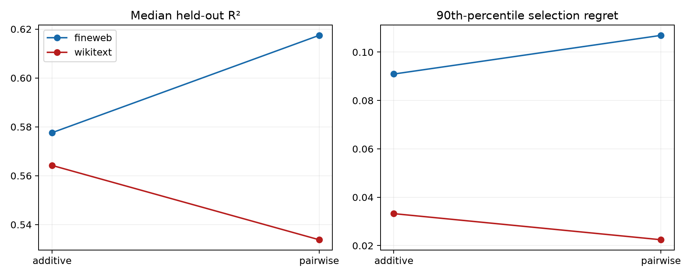

# Interaction grammar of the Layer-8 suffix masks

Additive and pairwise set functions are fit separately at each site and evaluated on held-out three-layer masks. Selection regret asks whether the fitted surface identifies a good unseen mask, not just whether it predicts average scores.

## Locked hypotheses

- **G0_additive_mask_grammar: not supported.**
- **G1_pairwise_mask_grammar: not supported.**
- **G2_pairwise_interactions_are_necessary: not supported.**
- **G3_higher_order_or_missing_variables: supported.**

| Corpus | Target | Model | Median R2 | 10th-percentile R2 | Median regret | 90th-percentile regret |
|---|---|---|---:|---:|---:|---:|
| fineweb | full_fidelity | additive | 0.578 | 0.067 | 0.003 | 0.091 |
| fineweb | full_fidelity | pairwise | 0.617 | 0.207 | 0.002 | 0.107 |
| fineweb | objective_efficiency | additive | 0.624 | 0.300 | 0.001 | 0.060 |
| fineweb | objective_efficiency | pairwise | 0.633 | 0.327 | 0.000 | 0.018 |
| wikitext | full_fidelity | additive | 0.564 | 0.148 | 0.002 | 0.033 |
| wikitext | full_fidelity | pairwise | 0.534 | 0.220 | 0.002 | 0.022 |
| wikitext | objective_efficiency | additive | 0.545 | 0.124 | 0.003 | 0.048 |
| wikitext | objective_efficiency | pairwise | 0.565 | 0.257 | 0.002 | 0.029 |

These are site-local descriptions. Pairwise success would identify a short local grammar but not a cross-context address rule. Pairwise failure rejects this polynomial set-function audit, not all compact tensor factorizations.
