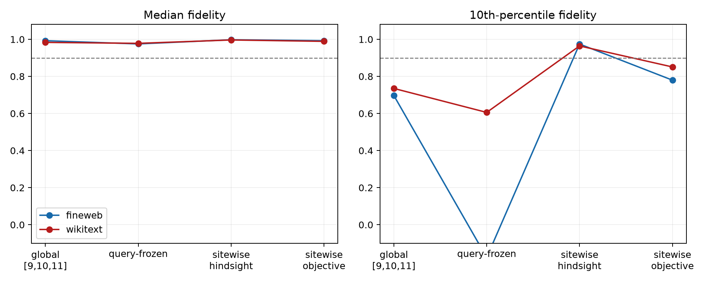

# Layer-8 compact suffix-route atlas

All 84 three-layer attention-JVP masks were evaluated at every site. Query masks were selected on the first FineWeb site and frozen for the second FineWeb site and both WikiText sites. Sitewise hindsight is an existence ceiling, not a deployable interpreter.

## Locked hypotheses

- **A0_sitewise_compact_route_exists: supported.**
- **A1_query_route_repeats: not supported.**
- **A2_local_route_atlas: supported.**
- **A3_some_sites_need_broad_suffix: not supported.**
- **A4_weight_objective_finds_route: supported.**

| Corpus | Method | Median fidelity | 10th percentile | Minimum |
|---|---|---:|---:|---:|
| fineweb | sitewise_by_full | 0.998 | 0.975 | 0.762 |
| fineweb | sitewise_by_objective | 0.993 | 0.780 | -1.655 |
| fineweb | sitewise_by_oracle | 0.991 | 0.700 | -0.963 |
| fineweb | query_frozen_by_objective | 0.974 | 0.365 | -0.988 |
| fineweb | query_frozen_by_full | 0.975 | -0.176 | -2.818 |
| fineweb | query_frozen_by_oracle | 0.955 | -0.659 | -2.818 |
| wikitext | sitewise_by_full | 0.996 | 0.964 | 0.800 |
| wikitext | sitewise_by_objective | 0.989 | 0.851 | -4.150 |
| wikitext | sitewise_by_oracle | 0.985 | -0.746 | -2.159 |
| wikitext | query_frozen_by_objective | 0.984 | 0.834 | -1.924 |
| wikitext | query_frozen_by_full | 0.978 | 0.606 | -2.585 |
| wikitext | query_frozen_by_oracle | 0.965 | 0.537 | -2.585 |

## Guardrails

A sitewise result uses the answer at that same site and cannot demonstrate a reusable router. Query-frozen transfer is the reusable-mechanism test. Failure of the weight-objective selector can mean finite-scale or selection-objective mismatch; it does not prove no compact mask exists.
