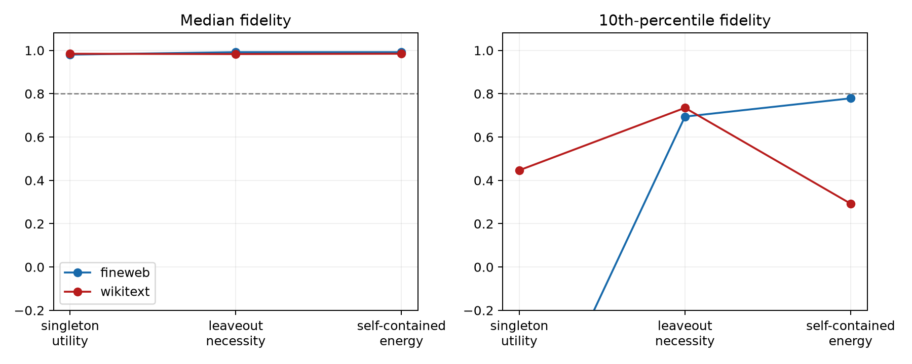

# Simple selectors for the Layer-8 suffix-route atlas

Three per-layer heuristics choose a size-3 mask without inspecting that mask's finite causal answer. Their selected masks are scored using the already frozen exhaustive-atlas interventions.

## Locked hypotheses

- **S0_singleton_utility_selects_route: not supported.**
- **S1_leaveout_necessity_selects_route: not supported.**
- **S2_self_contained_energy_selects_route: not supported.**
- **S3_strong_layer_synergy: supported.**

| Corpus | Selector | Median fidelity | 10th percentile | Minimum |
|---|---|---:|---:|---:|
| fineweb | singleton_utility | 0.980 | -0.934 | -2.818 |
| fineweb | leaveout_necessity | 0.992 | 0.694 | -2.684 |
| fineweb | self_contained_energy | 0.992 | 0.779 | -2.727 |
| wikitext | singleton_utility | 0.984 | 0.447 | -4.159 |
| wikitext | leaveout_necessity | 0.983 | 0.735 | -2.636 |
| wikitext | self_contained_energy | 0.985 | 0.292 | -2.636 |

The singleton and leaveout selectors use the full Gram diagnostically. Only self-contained energy avoids that target. Failure here rejects these short rules, not all learnable or higher-order routers.
