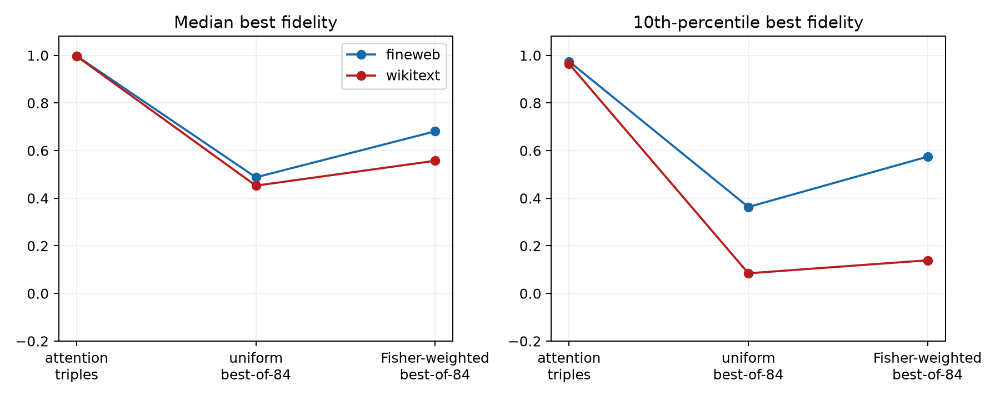

# Best-of-many null for the compact suffix-route atlas

The best of all 84 structured attention triples is compared with equal-size banks of uniform and full-Fisher-weighted random 16-mode programs. Every candidate is evaluated by an exact finite intervention.

## Locked hypotheses

- **N0_structured_beats_uniform: supported.**
- **N1_structured_beats_fisher_weighted: supported.**
- **N2_effect_collision_explains_atlas: not supported.**
- **N3_uniform_collision_explains_atlas: not supported.**

| Corpus | Bank | Median best fidelity | 10th percentile | Minimum |
|---|---|---:|---:|---:|
| fineweb | structured_best | 0.998 | 0.975 | 0.762 |
| fineweb | uniform_best | 0.488 | 0.363 | 0.266 |
| fineweb | weighted_best | 0.681 | 0.574 | 0.257 |
| wikitext | structured_best | 0.996 | 0.964 | 0.800 |
| wikitext | uniform_best | 0.453 | 0.085 | -0.083 |
| wikitext | weighted_best | 0.557 | 0.139 | 0.007 |

A random-bank match means that compact effect equivalence is common under this search budget; it does not mean random programs reproduce the same internal route. A structured advantage strengthens attention-route localization but still does not provide a reusable selector.
