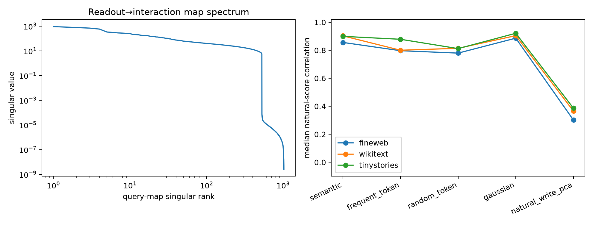

# Query-conditioned interaction interpreter

For the frozen layer-17 32D input subspace, the bilinear weights define an exact linear map from any residual readout direction to a 32×32 symmetric interaction matrix. This report tests whether those mapped scalar computations reproduce the full MLP on natural states for readout families not used to construct the subspace.

## Locked hypotheses

- **Q1_exact_query_map: supported.**
- **Q2_semantic_query_transfer: supported.**
- **Q3_frequent_token_transfer: supported.**
- **Q4_language_query_advantage: not supported.**
- **Q5_rank128_map_compression: supported.**
- **Q6_natural_write_queries: not supported.**

| Corpus | Semantic | Frequent token | Random token | Gaussian | Natural-write PCA |
|---|---:|---:|---:|---:|---:|
| fineweb | 0.856 | 0.797 | 0.780 | 0.886 | 0.302 |
| wikitext | 0.903 | 0.800 | 0.814 | 0.904 | 0.366 |
| tinystories | 0.899 | 0.878 | 0.812 | 0.921 | 0.387 |

The exact map check has maximum relative error `5.13e-07`. The map spectrum has fitted bulk exponent 0.838 with log-log R² 0.950; rank-128 contains 95.8% of global map energy.

This interpreter answers a declared scalar readout query. It is not a replacement for the entire MLP, and high correlation does not imply that the 32D state is sufficient for all logits simultaneously.
