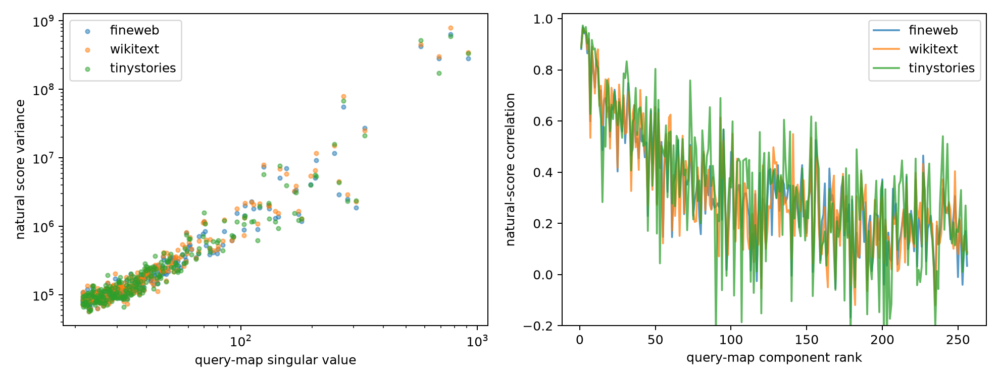

# Natural-state validation of query-map spectral components

For each of the leading 256 query-map singular components, the full MLP scalar score is compared with its 32D interaction-matrix prediction on three corpora. Spectral strength, target variance, and predictive fidelity are reported separately.

## Locked hypotheses

- **C1_spectral_strength_tracks_variance: supported.**
- **C2_top_components_are_faithful: supported.**
- **C3_global_strength_variance_relation: supported.**
- **C4_global_strength_fidelity_relation: supported.**
- **C5_top4_cleaner_than_top32: supported.**

| Corpus | Top-4 corr | Top-32 corr | Middle-32 corr | Top/middle variance | Strength↔variance | Strength↔fidelity |
|---|---:|---:|---:|---:|---:|---:|
| fineweb | 0.944 | 0.689 | 0.300 | 24.12 | 0.940 | 0.726 |
| wikitext | 0.951 | 0.711 | 0.287 | 26.07 | 0.922 | 0.686 |
| tinystories | 0.957 | 0.745 | 0.330 | 22.20 | 0.911 | 0.656 |

A strong weight singular component is a candidate operation. It is only a validated circuit direction if its natural score is also predicted by the restricted state and its proposed semantic/causal role survives independent tests.
