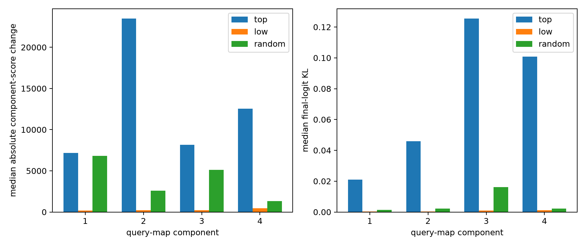

# Finite circuit tests for the leading query-map components

The leading four readout→interaction singular components are expanded into output token roles, 32D input interaction matrices, natural context tails, and norm-matched finite edits of top, low, and random four-dimensional input eigenspaces.

## Locked hypotheses

- **O1_low_rank_input_forms: supported.**
- **O2_top_modes_specific: supported.**
- **O3_weight_prediction_matches_finite_effect: not supported.**
- **O4_top_modes_reach_logits: supported.**
- **O5_random_control: supported.**

| Component | Best output predicate | Output AUROC | Top-4 matrix energy | Scan corr | Top/low scalar effect | Top/low KL | Finite prediction corr |
|---:|---|---:|---:|---:|---:|---:|---:|
| 1 | newline | 0.985 | 0.952 | 0.904 | 43.55× | 69.50× | 0.999 |
| 2 | newline | 0.967 | 0.966 | 0.969 | 118.86× | 121.35× | 0.899 |
| 3 | all_caps | 0.884 | 0.919 | 0.947 | 39.00× | 137.02× | 0.999 |
| 4 | comma_period | 0.767 | 0.964 | 0.945 | 28.78× | 80.21× | 0.290 |

Full context tails and promoted/suppressed token examples are stored in `query_map_outlier_circuits.json`. These are candidate circuits only at the declared output-component readout; null comparisons showed that broad token-predicate AUROC alone is not sufficient evidence.
