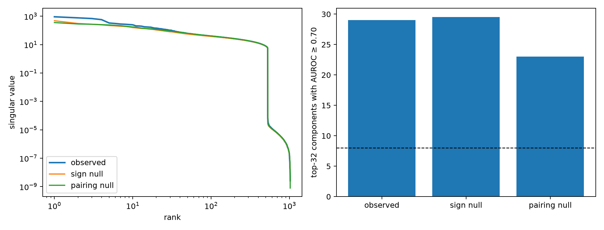

# Spectral red-team of the query-conditioned map

The 1,152→32×32 readout-to-interaction map is compared with six channel-sign nulls and six Down-to-factor pairing nulls. The bulk fit is frozen to ranks 33–512; outlier excess extrapolates that fit to ranks 1–4. Leading output singular vectors are independently tested against 14 token predicates.

## Locked hypotheses

- **N1_generic_power_law_bulk: supported.**
- **N2_observed_outlier_excess: supported.**
- **N3_semantic_outlier_components: supported.**
- **N4_semantics_exceed_null: not supported.**
- **N5_not_just_write_pca: not supported.**

| Spectrum | Exponent | Bulk R² | Top-four log excess | Semantic top-32 |
|---|---:|---:|---:|---:|
| observed | 0.838 | 0.950 | -0.323 | 29 |
| sign null median | 0.794 | 0.940 | -0.946 | 29.5 |
| pairing null median | 0.835 | 0.947 | -1.249 | 23.0 |

Mean canonical overlap with natural-write PCA is 0.905 at rank 4, 0.617 at rank 16, and 0.611 at rank 64.

The observed top-four log deviation is negative: the leading singular values are stronger than every tested null relative to their bulks, but remain below a naive extrapolation of the observed rank-33–512 power law. This is comparative top-spectrum structure, not yet a strict above-power-law outlier.

The semantic-count test also fails as an independent circuit criterion: sign-null output directions are drawn from the same learned Down/unembedding geometry and score equally well under the broad predicate vocabulary.

A power-law fit and an outlier are structural clues, not circuit validation. Semantic alignment is tested separately, and the nulls preserve parameter norms while disrupting different kinds of learned coordination.
