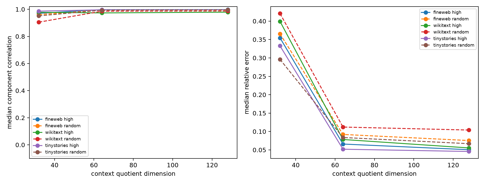

# Generalization of the context-conditioned tangent interpreter

The top-mode finite-effect calculation is extended to sixteen query-map components, high-score and random sites, and disjoint FineWeb/WikiText/TinyStories panels. Effects are algebraically exact full-form calculations; only the context x is compressed.

## Locked hypotheses

- **G1_high_score_generalization: supported.**
- **G2_component_coverage: supported.**
- **G3_random_site_generalization: supported.**
- **G4_context_gain: not supported.**
- **G5_hybrid128_calibration: not supported.**

| Corpus | Stratum | 32D corr / R² | 64D corr / R² | 128D corr / R² | 128D rel. error |
|---|---|---:|---:|---:|---:|
| fineweb | high | 0.970 / 0.854 | 0.997 / 0.985 | 0.998 / 0.994 | 0.051 |
| fineweb | random | 0.961 / 0.879 | 0.994 / 0.987 | 0.996 / 0.990 | 0.075 |
| wikitext | high | 0.978 / 0.877 | 0.973 / 0.939 | 0.979 / 0.953 | 0.055 |
| wikitext | random | 0.905 / 0.808 | 0.986 / 0.972 | 0.988 / 0.970 | 0.104 |
| tinystories | high | 0.986 / 0.935 | 0.996 / 0.981 | 0.997 / 0.986 | 0.046 |
| tinystories | random | 0.952 / 0.887 | 0.993 / 0.983 | 0.996 / 0.991 | 0.067 |

Correlation measures directional prediction across sites; relative error also penalizes calibration. Random-site effects can be much smaller, so both statistics are required.
